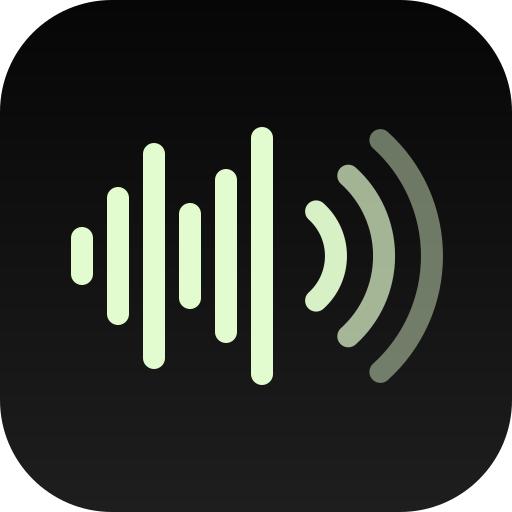
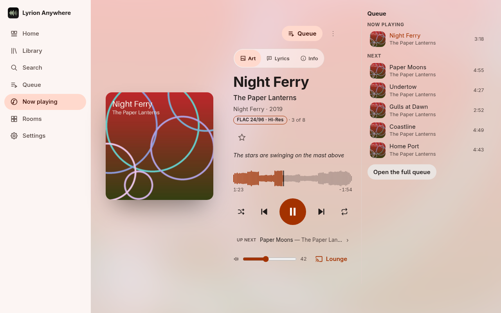
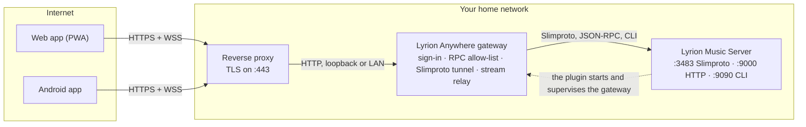

  

<h1 align="center">Lyrion Anywhere</h1>

<strong>Lyrion Music Server, brought into the mobile age: any device becomes a player, anywhere.</strong>

  <a href="https://github.com/JameZUK/lyrion-anywhere/releases"><strong>Releases</strong> (Android app and LMS plugin)</a> ·
  <a href="docs/INSTALL.md">Installation guide</a> ·
  <a href="docs/FEATURES.md">All features</a> ·
  <a href="docs/README.md">Documentation</a>

[Lyrion Music Server](https://lyrion.org) (LMS, formerly Logitech Media Server) is the community-run heart of the Squeezebox world: one server for your whole library, driving Squeezeboxes, software players and hi-fi streamers in sync around the house. Lyrion Anywhere takes it beyond the house. Every phone, tablet and browser you sign in on becomes a real LMS player, from anywhere: on the train on mobile data, on a laptop at work, in the car. It streams your library losslessly, plays in step with the players at home, and can control them and move playback between them. LMS itself never touches the internet: one small, hardened gateway behind your own HTTPS reverse proxy is the only thing anyone outside your home can reach.

  

> Screenshots come from the built-in demo ([`tools/demo`](tools/demo)) and the Android app's screenshot tests. The library, players, people and artwork in them are invented.

## What it can do

- **Any phone, tablet or browser is a real LMS player, from anywhere.** It appears in LMS like a Squeezebox, on home Wi-Fi or on mobile data, so gapless playback, alarms, plugins and play counts all work as they do on any player.
- **It plays in sync with the players at home.** Your phone, or your browser (including Safari on an iPad, installed as an app and playing in the background), joins a sync group with the Squeezeboxes and other players at home and stays in step with them: it reports what is actually heard, allowing for output and Bluetooth latency, and applies LMS's sync corrections at the output.
- **A dropped connection doesn't break the group.** The gateway holds the player's place in LMS (up to ten minutes on Android) while the phone plays on from what it has read ahead; when the link returns it rejoins in step without pausing the rest of the group or moving it back. Regression tests against a fake LMS cover this, and an opt-in live check against a real LMS asserts it.
- **Tunnels and dead spots are ridden out.** The next track is fetched long before the current one ends, repeats play from a replay cache, and an album you've downloaded stands in for its stream.
- **Lossless and gapless by default.** FLAC plays as FLAC, decoded on the device. On Android the output is bit-perfect by default, to a USB DAC on Android 14 and later where the DAC supports it, and a signal path shows what happens to every sample.
- **Offline, properly.** Download albums, playlists, artists and tracks for offline listening; plays are counted in LMS when you're back, and pause, resume and skipping keep working on the device while the server is out of reach.
- **Nothing exposed but one TLS endpoint.** LMS's ports stay on your home network; the gateway allows only an explicit list of commands, scrubs file paths and LAN addresses from every answer, and has its own per-user accounts, two-step sign-in and a list of your signed-in devices.
- **Frugal on mobile data when you want it.** With `ffmpeg` on the server, the gateway re-encodes FLAC to Opus on the fly; Android plays Original on Wi-Fi and High (Opus 160 kb/s) on mobile data by default.
- **Everything else LMS has.** Your whole library, every app, radio service and plugin LMS offers (podcasts, streaming services, AudioMuse-AI and more), alarms, Rooms, and *Move playback* between any players.
- **At home in the car and on the phone.** Android Auto, car mode, widgets, a Quick Settings tile, layouts for tablets and foldables, and optional DSP (levelling, EQ, crossfeed), all off by default.

The full list, with the platforms each feature runs on, is in [`docs/FEATURES.md`](docs/FEATURES.md).

## Under the bonnet

- **One Rust player core, with no I/O of its own.** The same core (Slimproto, the player state machine, decoding, DSP and track analysis) runs in the browser as WebAssembly and in the Android app's native engine; each host only drives the network and the audio output.
- **Its own decoders.** FLAC, ALAC, MP3, AAC-LC, Vorbis and WAV/AIFF through Symphonia, and Opus through a pure-Rust decoder (no `unsafe`, no C), patched here to decode at about 170× real time on one desktop core. Every decoder is fed random, truncated and oversize input in tests and must never panic.
- **64-bit DSP that steps aside.** On Android, levelling (ReplayGain or the server's EBU R128 analysis), parametric EQ with AutoEq profiles, loudness-compensated volume, crossfeed, a 4× oversampled true-peak limiter, dither and transitions all work on `f64` samples. A bypassed stage leaves the samples untouched, so with everything off the chain is bit-transparent, which tests prove at every common rate and depth; the output then opens at the track's own rate, bit-perfect to a USB DAC on Android 14 and later.
- **What you hear, shown.** The gateway analyses each track (a 1,000-point waveform, R128 loudness, peaks, silences and fades) for the waveform seek bar and levelling, and the signal path lists every stage from source to output, with a bit-perfect verdict on Android.
- **One small gateway, run by the plugin.** A single Rust gateway behind your own reverse proxy (10.8 MB resident after two hours serving a household, in one measurement), installed, started and supervised by the LMS plugin. It keeps its own per-user accounts: argon2id passwords, optional TOTP two-step sign-in, 15-minute access tokens and rotating refresh tokens.
- **A player link that survives the network.** Each device's Slimproto connection is tunnelled over a secure WebSocket and resumed after a dropout while the gateway stands in for the player; on Android a rolling cache (a disk spool, read-ahead of the next track, a replay cache) keeps the music going meanwhile.

The detail, with request flows and sequence diagrams, is in [`docs/ARCHITECTURE.md`](docs/ARCHITECTURE.md); the measurements are in [`docs/PERFORMANCE.md`](docs/PERFORMANCE.md).

  
  &nbsp;
  
  &nbsp;
  

<strong>More screenshots</strong>

**Web app**

  
  
  
  

  
  

  
  

**Android app**

  
  
  
  

  
  
  
  

  
  

  

## How it works

- **Clients** speak only HTTPS and secure WebSockets, to your reverse proxy (nginx, Caddy, Traefik or a Cloudflare Tunnel).
- **The gateway** is the only process the proxy forwards to. It signs devices in, passes allow-listed LMS commands through and scrubs the answers, tunnels each device's Slimproto player connection over a WebSocket (resuming it after a dropout), and relays audio with a replay window so a broken stream carries on from where it stopped.
- **The LMS plugin** starts the gateway, restarts it if it stops, and adds a settings page for users, devices and options. Accounts live in the gateway's own database, not in LMS.
- **LMS's ports (3483, 9000, 9090) are never forwarded.**

The detailed design, with request flows and sequence diagrams, is in [`docs/ARCHITECTURE.md`](docs/ARCHITECTURE.md); the security model is summarised in [`docs/SECURITY.md`](docs/SECURITY.md).

## Quick start

You need LMS 9.0 or later, a domain name with port 443 forwarded, and a reverse proxy with a certificate. Step by step: [`docs/INSTALL.md`](docs/INSTALL.md).

1. **Install the plugin** in LMS: *Settings › Plugins*, add the repository `https://github.com/JameZUK/lyrion-anywhere/releases/latest/download/repo.xml`, tick **Lyrion Anywhere** and restart LMS. (No plugin binary for your platform? Run the gateway with Docker: see [`docs/DEPLOY.md`](docs/DEPLOY.md).)
2. **Put an HTTPS reverse proxy in front of it** for a name such as `music.example.com` (a tested nginx configuration is in [`deploy/nginx`](deploy/nginx); with Caddy it is two lines), then set the Public URL and create users on the plugin's settings page.
3. **Sign in:** open `https://music.example.com` on your phone, or install the [Android app](docs/PLATFORMS.md#getting-the-android-app) and scan the QR code from *Add a device*.

## Documentation

| Page | What it covers |
|---|---|
| [`docs/INSTALL.md`](docs/INSTALL.md) | Step-by-step installation, users, first sign-in, troubleshooting |
| [`docs/DEPLOY.md`](docs/DEPLOY.md) | Deployment reference: plugin, Docker, reverse proxy, CDN |
| [`docs/FEATURES.md`](docs/FEATURES.md) | Highlights, then every feature by area with the platforms it runs on |
| [`docs/PLATFORMS.md`](docs/PLATFORMS.md) | Supported browsers and devices, getting the Android app, project status and roadmap |
| [`docs/SECURITY.md`](docs/SECURITY.md) | Security and privacy in brief, and how to report a vulnerability |
| [`docs/PRIVACY.md`](docs/PRIVACY.md) | The full privacy policy: what each part stores, where and for how long |
| [`docs/ARCHITECTURE.md`](docs/ARCHITECTURE.md) | Components, trust boundary, request flows, storage, testing |
| [`docs/PROTOCOL.md`](docs/PROTOCOL.md) | The public API and player protocol, the command policy and security rules |
| [`docs/PERFORMANCE.md`](docs/PERFORMANCE.md) | Android performance budgets and how to measure them |
| [`docs/BUILDING.md`](docs/BUILDING.md) | Building and testing from source, the demo, contributing |
| [`docs/RELEASING.md`](docs/RELEASING.md) | How plugin and Android releases are made |
| [`docs/security/`](docs/security) | Security reviews and penetration tests |
| [`SPEC.md`](SPEC.md) | The design and every decision behind it |
| [`CHANGELOG.md`](CHANGELOG.md) | What changed and when, newest first |
| [`docs/README.md`](docs/README.md) | Index of all documentation, including design plans and release notes |

## Licence

GPL-2.0-or-later (see [`LICENSE`](LICENSE)); binaries that include Apache-2.0-licensed dependencies are distributed under the terms of GPLv3. The project's own code also carries an additional permission that lets the apps be distributed through app stores such as Apple's App Store, as long as the full source stays available under the GPL: see [`LICENSE-EXCEPTION`](LICENSE-EXCEPTION).

## Acknowledgements

With thanks to [Lyrion Music Server](https://lyrion.org) and its community (Lyrion Anywhere is an independent project, not an official Lyrion one); to [squeezelite](https://github.com/ralph-irving/squeezelite) and [Material Skin](https://github.com/CDrummond/lms-material), references for behaviour only in this clean-room implementation; and to the open-source building blocks listed in [`docs/BUILDING.md`](docs/BUILDING.md#acknowledgements).
