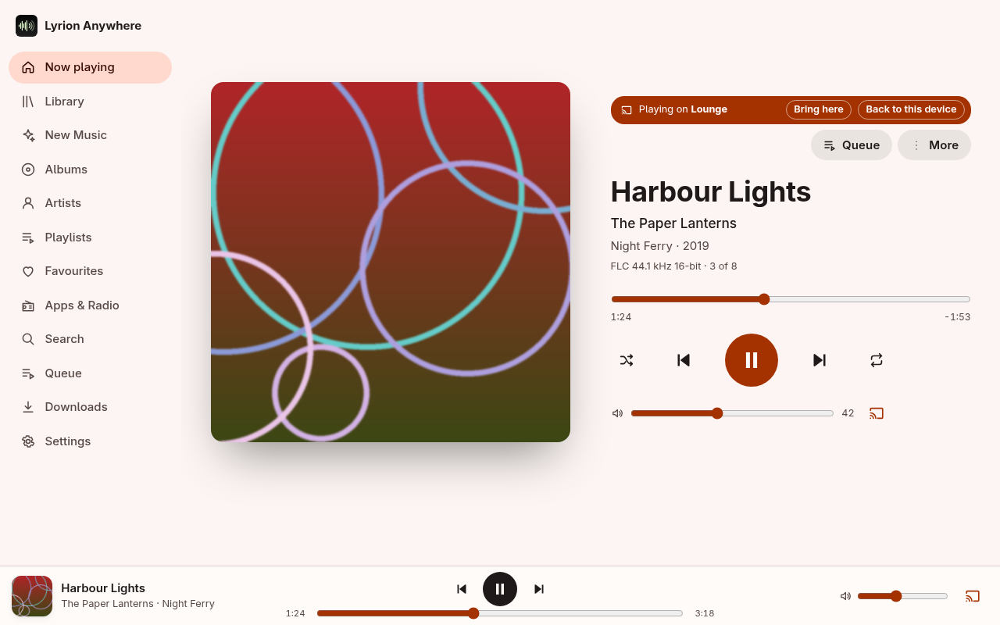
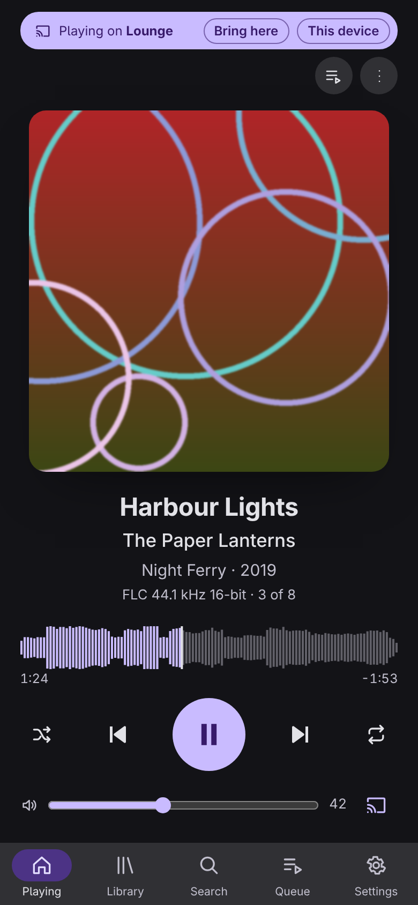
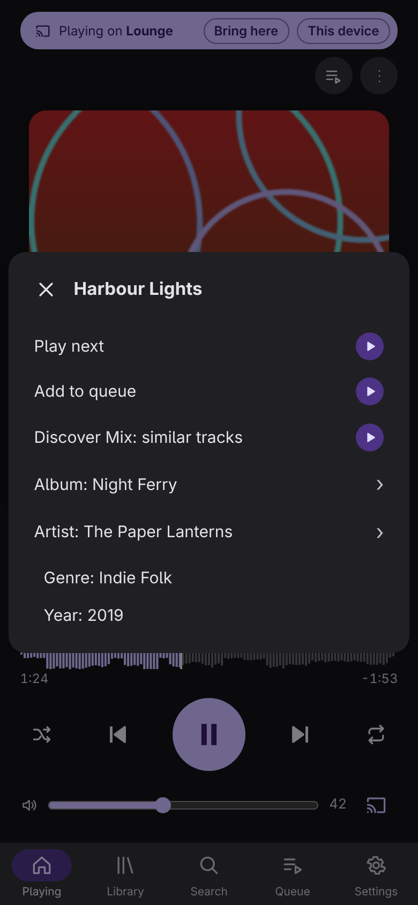
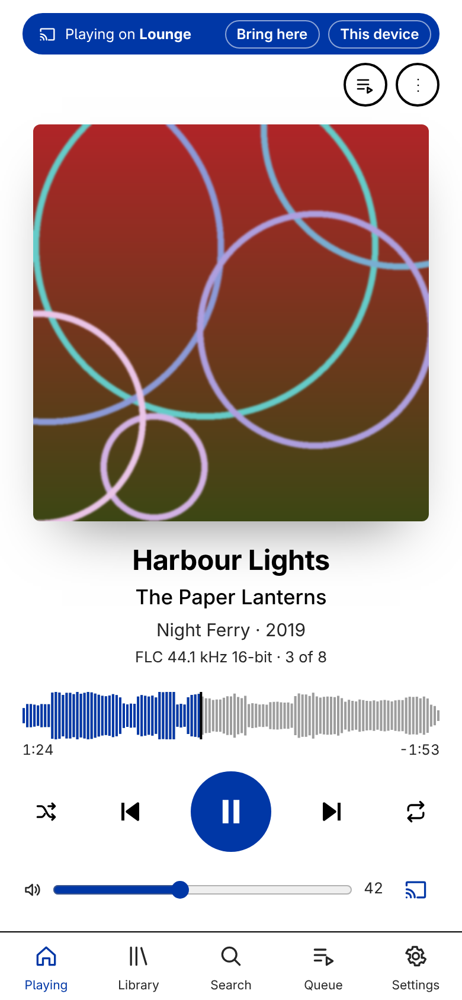
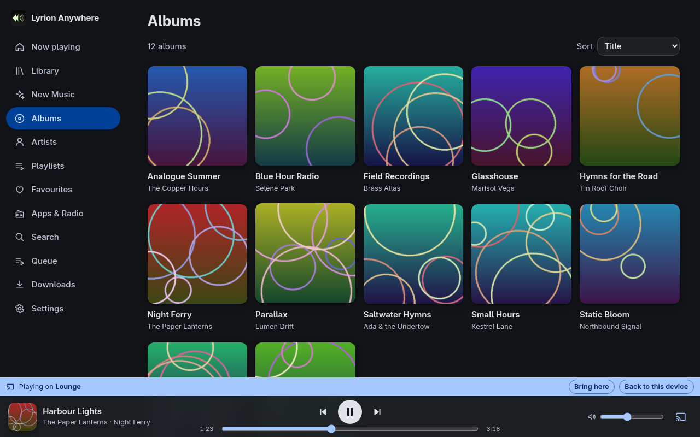
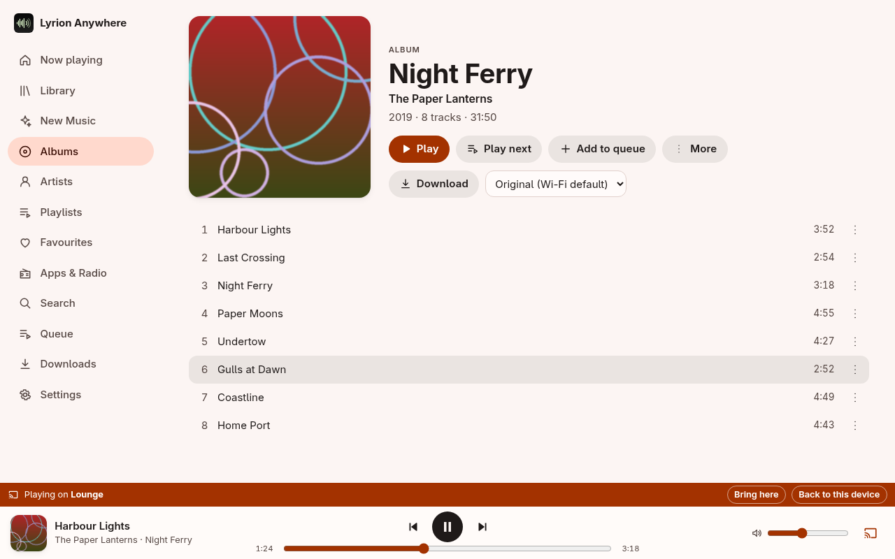
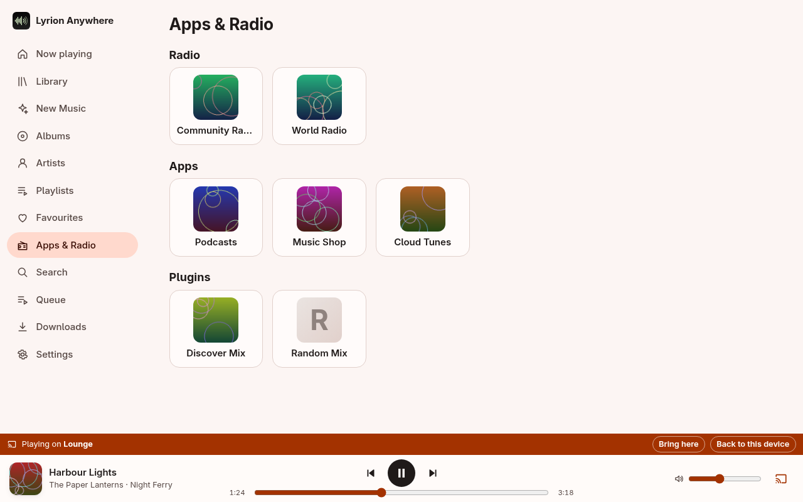
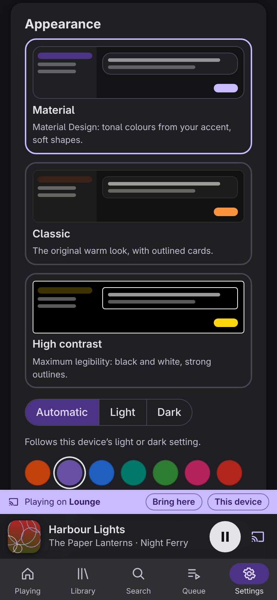
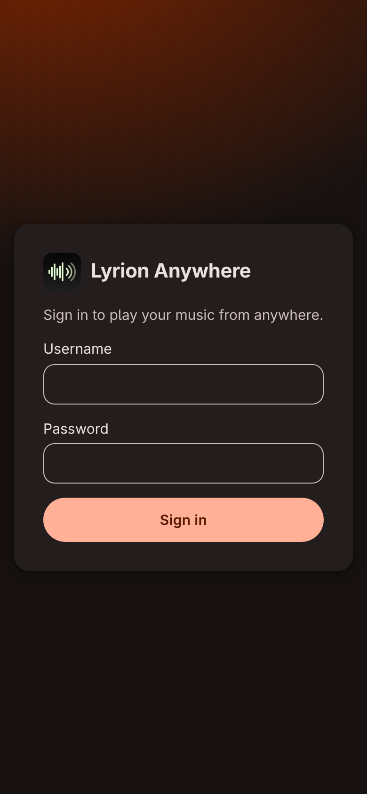
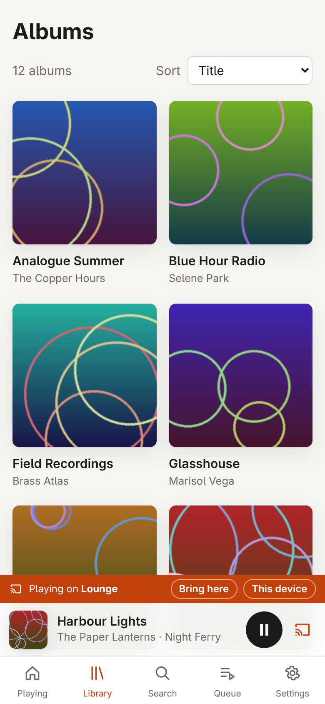

<p align="center">
  
</p>

<h1 align="center">Lyrion Anywhere</h1>

<p align="center"><strong>Your <a href="https://lyrion.org">Lyrion Music Server</a> from anywhere: securely, losslessly, in any modern browser.</strong></p>

Lyrion Anywhere gives your phone, tablet or laptop secure access to your LMS library over the internet. A browser can be a remote control for your home players, or a player itself, streaming your music losslessly. LMS stays on your home network: only one small, hardened gateway faces the internet, behind your HTTPS reverse proxy.

<p align="center">
  
</p>

<p align="center">
  
  &nbsp;
  
  &nbsp;
  
</p>

> Screenshots come from the built-in demo ([`tools/demo`](tools/demo)). The library, players and artwork are invented, so nothing here comes from a real installation.

## Features

**Play anywhere**
- **Plays on this device by default.** The browser becomes an LMS player as soon as you sign in, so the first tap on Play starts the music right there. It is lossless (FLAC, MP3, Ogg and more are decoded on the device) and works with gapless playback and synchronisation like any other player. Settings › This device can start on another player instead.
- **Remote control** for every LMS player you're allowed to use: play, pause, seek, skip, volume, shuffle, repeat and the queue. The small output button by the volume opens *Play on…*, and a coloured strip says when you're controlling another player, with one tap back.
- **Move playback between players.** *Move here* carries the queue on another player from the same point, and stops it where it was; *Bring here* does the reverse. Radio and app streams move too.
- **Background playback** on phones and tablets. The app checks each browser and picks the best playback mode by itself:
  - *Web Audio:* lowest latency, used on desktops;
  - *the media element:* survives the screen locking on Android and iOS, with lock-screen controls.
- **Picks up where you left off.** Reload the page and playback carries on, on the same track and at the same time.

**Your whole library and LMS**
- Albums, artists, playlists, favourites, search, the queue, and track, album and artist details.
- **Apps, radio and plugins, found automatically.** Whatever your LMS offers (podcasts, radio directories, streaming services, AudioMuse-AI, Custom Browse, Random Mix…) appears with nothing hard-coded. Plugins that need setting up in LMS say so, and empty or broken ones are tucked away.
- **Context menus** ("More…") with every action LMS and its plugins offer for a track, album or artist.

**Made for phones as much as desktops**
- **Installable app** (PWA) on iPhone, iPad, Android and desktop: full screen, with its own icon, and it opens even offline.
- **Themes:**
  - **Material** (Material Design 3, with an accent colour of your choice);
  - **Classic**;
  - **High contrast**.
- Light, dark or automatic mode. Every colour combination is tested for legibility.

**Security first**
- **LMS is never exposed.** Only the gateway is reachable, through your TLS reverse proxy. Every command is checked against an allow-list, plugin actions run only if LMS offered them to that device, and responses are stripped of file paths and LAN addresses.
- **Accounts:**
  - per-user accounts with *admin* and *listener* roles;
  - listeners control only their own devices and the players you grant them;
  - optional two-step verification (TOTP);
  - sign-in lockouts;
  - sign-ins that stay valid with use, for a period you choose.
- **Per-plugin access:** reserve any plugin for admins (e.g. one with server maintenance actions).
- **Built for scrutiny:**
  - a strict Content Security Policy;
  - no third-party code at runtime;
  - fuzz and negative tests on every parser and endpoint;
  - CI on every change.

## How it works

```
 phone / browser ──HTTPS──▶ reverse proxy ──HTTP──▶ gateway ──▶ LMS (your LAN)
  (web app, player)          (nginx, Caddy…)        (LMS plugin)   3483 / 9000 / 9090
```

- **The LMS plugin** runs the gateway, keeps it running and adds a settings page for users, devices and options.
- **The gateway** (Rust) is the only internet-facing part:
  - signs devices in;
  - relays permitted LMS commands;
  - tunnels each browser player's Slimproto connection to LMS;
  - relays the audio stream, resuming it if the connection drops.
- **The web app** (SvelteKit). For playback, it runs the player core (Rust, compiled to WebAssembly) in a worker.

The full design is in [`SPEC.md`](SPEC.md), and the API and protocol in [`docs/PROTOCOL.md`](docs/PROTOCOL.md).

## Getting started

**→ Step-by-step installation: [`docs/INSTALL.md`](docs/INSTALL.md)**

In short:

1. **Install the plugin** in LMS (*Settings › Plugins*), or run the gateway with Docker.
2. **Put a reverse proxy in front of the gateway,** with an HTTPS certificate for a name such as `music.example.com`.
3. **Create users** on the plugin's settings page.
4. **Open `https://music.example.com`** on your phone, sign in, and optionally *Add to Home Screen*.

Requirements:
- **LMS:** 9.0 or later, on Linux (x86_64, aarch64 or armhf for the bundled gateway; other platforms via Docker);
- **Proxy:** a domain name and a reverse proxy with TLS;
- **Browsers:** current Chrome, Edge, Firefox or Safari (iOS/iPadOS 17+).

## Screenshots

| | |
|---|---|
|  |  |
| *Albums: Material theme, dark, blue accent* | *An album* |
|  |  |
| *Apps, radio and plugins, found automatically* | *Settings › Appearance* |
|  |  |
| *Sign-in* | *Classic theme* |

## Try it without an LMS

The demo runs the real gateway and web app against an invented library:

```sh
cargo build -p anywhere-gateway
tools/build-web.sh                 # needs wasm-pack and Node 22+
python3 -m pip install pillow      # for the generated artwork
tools/demo/run.sh                  # then open http://127.0.0.1:19443  (demo / demo-password-123)
```

`node tools/demo/screenshots.mjs` regenerates the images in this README. It needs `playwright-core` and a Chromium.

## Project layout

| Path | What |
|---|---|
| `core/` | Rust player core: Slimproto, buffering, decoding, the lossless media-element encoder. No I/O; builds natively and as WebAssembly |
| `gateway/` | Rust gateway: accounts and sign-in, command policy, Slimproto tunnel, stream relay, admin API |
| `wasm/` | WebAssembly bindings for the core |
| `web/app/` | The web app (SvelteKit, Svelte 5, TypeScript) |
| `plugin/` | The LMS plugin (Perl): gateway supervision, settings page, `anywhere …` commands |
| `cli/` | Native test player for the core |
| `deploy/` | Example reverse-proxy configuration (nginx), tested in CI |
| `tools/` | Build, release and deployment-test scripts; the demo |
| `docs/` | Installation, deployment reference, protocol |

## Development

```sh
cargo test --workspace                                  # core, gateway (unit + end-to-end against a fake LMS)
cargo clippy --workspace --all-targets
tools/build-web.sh                                      # WebAssembly core + web app into web/app/build
cd web/app && npm run check && npm test                 # strict type check; Vitest + Node tests
cd plugin && PERL5LIB=t/stubs:. prove -r t/ && node --test t/js/*.test.mjs
```

The plugin's contract test also runs the real gateway, so build it first (`cargo build -p anywhere-gateway`). `cd web/app && npm run dev` starts a dev server that proxies `/v1` to a gateway on `127.0.0.1:9443`.

**Rules for contributions** (see [`CLAUDE.md`](CLAUDE.md)):
- **Tests at every point, security first:** negative tests for every reachable surface, fuzz/robustness tests for every parser, and a regression test for every security fix.
- **No personal or environment details in the repository:** use placeholders such as `music.example.com`, `10.0.0.10` and `/srv/music`. Keep real values in git-ignored `dev/local.*` files.
- **Clean-room implementation:** squeezelite and Material Skin are behavioural references only.

## Security

Please report vulnerabilities privately through GitHub's *Report a vulnerability* (Security tab) rather than in a public issue. The threat model and the decisions behind it are in [`SPEC.md`](SPEC.md).

## Licence

GPL-2.0-or-later. See [`LICENSE`](LICENSE). Binaries that include Apache-2.0-licensed dependencies are distributed under the terms of GPLv3.

Squeezelite and Material Skin served as behavioural references only. No code was copied from either.

The logo is an original design in the spirit of the Lyrion Music Server logo: a waveform turning into broadcast waves, for your music reaching you wherever you are. It is not an official Lyrion project or logo.
