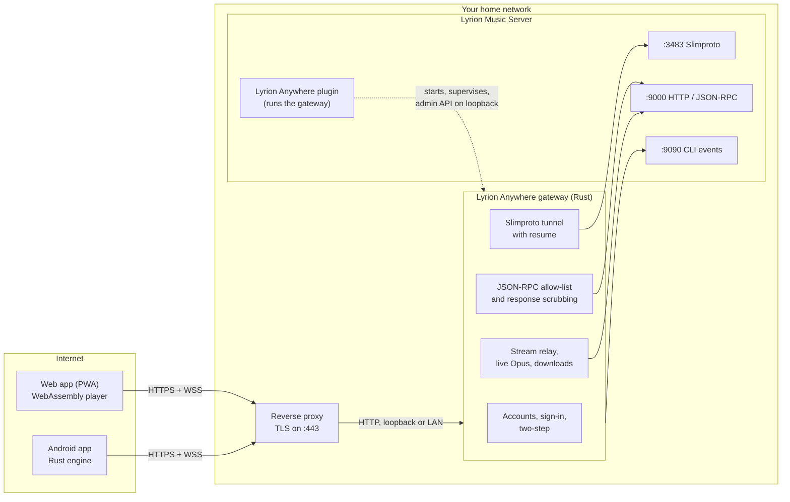

<p align="center">
  
</p>

<h1 align="center">Lyrion Anywhere</h1>

<p align="center"><strong>Your <a href="https://lyrion.org">Lyrion Music Server</a>, anywhere: securely, losslessly, in any modern browser and in a native Android app.</strong></p>

<p align="center">
  <a href="https://github.com/JameZUK/lyrion-anywhere/releases"><strong>Releases</strong> (Android app and LMS plugin)</a> ·
  <a href="docs/INSTALL.md">Installation guide</a> ·
  <a href="docs/FEATURES.md">All features</a> ·
  <a href="docs/ARCHITECTURE.md">Architecture</a>
</p>

Lyrion Anywhere lets you listen to the music on your home Lyrion Music Server (LMS) from anywhere: on your phone on the train, on a laptop at work, in the car. Every phone, tablet and browser you sign in on becomes a real LMS player, streaming your library losslessly, and can also control your home players and move playback between them.

LMS itself never touches the internet. One small, hardened gateway sits behind your own HTTPS reverse proxy, and it is the only thing anyone outside your home can reach.

<p align="center">
  
</p>

> Screenshots come from the built-in demo ([`tools/demo`](tools/demo)) and the Android app's screenshot tests. The library, players, people and artwork in them are invented.

## Who it is for

- **LMS owners who want their music away from home** without a VPN and without exposing LMS to the internet.
- **Households:** give each person their own account, with their own devices, history and settings. Guests can be limited to the players you choose.
- **Listeners who care about sound:** lossless and gapless by default, bit-perfect to a USB DAC on Android, and a signal path that shows exactly what happens to every sample.

## What makes it different

- **Every device is a real player.** Your phone or browser appears in LMS as a Squeezebox-style player, so gapless playback, sync groups, alarms, plugins and play counts all work as they do on any LMS player. It is not a remote control that needs another speaker.
- **Secure by design.** LMS's own ports stay on your home network. The gateway allows only an explicit list of commands, checks every argument, strips file paths and LAN addresses from every answer, and has its own accounts with optional two-step verification.
- **Lossless where it matters, frugal where it counts.** FLAC plays as FLAC. On mobile data the gateway can re-encode to Opus on the fly, and offline downloads can be the original files or smaller copies.
- **A native Android app**, sharing a Rust audio engine and network layer with the planned iOS app: bit-perfect USB output, optional DSP, Android Auto, offline downloads, and read-ahead that rides out tunnels and dead spots.
- **Made for LMS.** Apps, radio and plugins (AudioMuse-AI, Custom Browse, podcasts, streaming services and more) appear by themselves, with nothing hard-coded.

## Highlights

### In the browser (installable web app)

<p align="center">
  
  &nbsp;
  
  &nbsp;
  
</p>

- **Plays on the device straight away:** sign in and press Play. Lossless decoding runs in WebAssembly; on iPhone, iPad and Android it keeps playing with the screen locked.
- **Your whole library:** New Music, albums, artists by role, genres, years, compilations, the music folder, playlists, favourites, smart filters, and every app and radio service LMS offers.
- **Now playing that earns its space:** waveform seek bar, synced lyrics, artist biographies, a visualiser, a quality badge that opens the signal path, and a sleep timer.
- **Your own Home, stations and listening stats,** including a "Your year in sound" story you can share as an image made on the device.
- **Rooms:** every player at a glance; drag one onto another to sync them.

### On Android (native app)

<p align="center">
  
  &nbsp;
  
  &nbsp;
  
</p>

- **Bit-perfect audio:** a Rust engine with AAudio output, bit-perfect by default, and bit-perfect to a USB DAC on Android 14 and later where the DAC supports it.
- **Optional DSP, all off by default:** loudness levelling (ReplayGain or the server's EBU R128 analysis), parametric EQ with AutoEq import and per-output profiles, loudness-compensated volume, crossfeed, dither, and smart crossfades that never cross into a gapless album.
- **Android Auto, car mode, widgets, a Quick Settings tile and app shortcuts.**
- **Offline:** downloads (including smart downloads of recent albums and favourites), an offline mode, and plays counted in LMS when you are back online.
- **Gaps in the signal:** the next track is fetched long before the current one ends, and a session survives up to ten minutes without a connection.
- **Layouts for phones, tablets and foldables.**

**Get it:** signed APKs are on the [releases page](https://github.com/JameZUK/lyrion-anywhere/releases) (tags `android-v*`); `…-arm64-v8a.apk` suits most phones and the universal `.apk` works on any. Check the files against `SHA256SUMS`. Google Play and F-Droid listings are being prepared. The source is in [`apps/android`](apps/android).

## How it works



- **Clients** speak only HTTPS and secure WebSockets, to your reverse proxy (nginx, Caddy, Traefik or a Cloudflare Tunnel).
- **The gateway** is the only process the proxy forwards to. It signs devices in, passes allow-listed LMS commands through and scrubs the answers, tunnels each device's Slimproto player connection over a WebSocket (resuming it after a dropout), and relays audio with a replay window so a broken stream carries on from where it stopped.
- **The LMS plugin** starts the gateway, restarts it if it stops, and adds a settings page for users, devices and options. Accounts live in the gateway's own database, not in LMS.
- **LMS's ports (3483, 9000, 9090) are never forwarded.**

The detailed design, with request flows and sequence diagrams, is in [`docs/ARCHITECTURE.md`](docs/ARCHITECTURE.md).

## Features at a glance

Each group has a full breakdown, with the platforms each feature runs on, in [`docs/FEATURES.md`](docs/FEATURES.md).

| Area | In short |
|---|---|
| [Playback](docs/FEATURES.md#playback) | The device is a real LMS player; lossless and gapless; background playback; resume after dropouts and reloads; sleep timer; lower-data streams on mobile data |
| [Players, rooms and sync](docs/FEATURES.md#players-rooms-and-sync) | *Play on…*, move playback between players, sync groups, Rooms, alarms |
| [Library and browsing](docs/FEATURES.md#library-and-browsing) | All of LMS's "My Music", virtual libraries, credits, A–Z scroller, smart filters, apps, radio and plugins |
| [Search](docs/FEATURES.md#search) | Grouped results, recent searches, search inside apps |
| [Queue](docs/FEATURES.md#queue) | Sections, drag, swipe, Undo, checked edits, album-aware shuffle |
| [Now playing](docs/FEATURES.md#now-playing-lyrics-visualiser-and-signal-path) | Waveform seek bar, lyrics, info, visualiser, quality badge and signal path, ratings |
| [Sound](docs/FEATURES.md#sound-and-dsp) | Bit-perfect output, levelling, EQ, loudness, crossfeed, dither, transitions (Android) |
| [Discovery](docs/FEATURES.md#discovery-and-radio) | Home shelves, stations, Start radio, More like this |
| [Offline](docs/FEATURES.md#offline-and-downloads) | Downloads in three formats, offline mode, plays synced back |
| [Your listening](docs/FEATURES.md#listening-history-stats-and-your-year) | Private listening history, stats, "Your year in sound" |
| [Car and system](docs/FEATURES.md#car-android-auto-widgets-and-system-surfaces) | Car mode, Android Auto, widgets, tile, shortcuts, haptics, Media Session |
| [Appearance and accessibility](docs/FEATURES.md#appearance-and-accessibility) | Material, Classic and High contrast themes; tested contrast; screen readers and keyboards |
| [Accounts and admin](docs/FEATURES.md#accounts-devices-roles-and-admin) | Per-user accounts, roles, player grants, QR pairing, device list, diagnostics |
| [Security](docs/FEATURES.md#security-features) and [privacy](docs/FEATURES.md#privacy-controls) | See below |

## Quick start

**Step by step: [`docs/INSTALL.md`](docs/INSTALL.md).** The reference for proxies and Docker is [`docs/DEPLOY.md`](docs/DEPLOY.md).

1. **Install the plugin** in LMS: *Settings › Plugins*, add the repository `https://github.com/JameZUK/lyrion-anywhere/releases/latest/download/repo.xml`, tick **Lyrion Anywhere** and restart LMS. (No plugin binary for your platform? Run the gateway with Docker instead.)
2. **Put an HTTPS reverse proxy in front of it,** for a name such as `music.example.com`. A tested nginx configuration is in [`deploy/nginx`](deploy/nginx); with Caddy it is two lines.
3. **Set the Public URL and create users** on the plugin's settings page (*Settings › Plugins › Lyrion Anywhere*).
4. **Sign in:** open `https://music.example.com` on your phone and sign in, then optionally *Add to Home Screen*. Or install the Android app and scan the QR code from *Add a device*.

**Requirements**
- Lyrion Music Server 9.0 or later. The plugin bundles the gateway for Linux on x86_64, aarch64 and armhf; elsewhere use Docker.
- A domain name, port 443 forwarded, and a reverse proxy with a certificate.
- Optional: `ffmpeg` on the gateway's machine, for MP3 and Opus downloads and lower-data streams.

## Security in brief

- **Nothing of LMS is exposed.** The gateway forwards only allow-listed commands with validated arguments; everything else is refused. Answers are scrubbed of file paths, LAN addresses, server identifiers and other servers' players.
- **Each device is held to its own player.** The Slimproto tunnel accepts only what a software player sends, pins the device's assigned player address, and never lets LMS redirect a device to another server.
- **Accounts of its own:** argon2id passwords, optional TOTP two-step verification, sign-in lockouts that strangers can't use to lock you out, 15-minute access tokens, rotating refresh tokens with reuse detection, and per-device revocation that takes effect at once.
- **Least privilege:** listeners control only their own devices and the home players an admin grants them. Plugins can be reserved for admins.
- **Hardened web app:** a strict Content Security Policy with no inline script, no third-party code at runtime, and metadata always rendered as text.
- **Tested like it matters:** negative tests for every endpoint, robustness tests for every parser, a regression test for every security fix, and reviews recorded in [`docs/security/`](docs/security).

More in [`docs/ARCHITECTURE.md`](docs/ARCHITECTURE.md#4-trust-boundary-and-threat-model) and [`SPEC.md`](SPEC.md) §9. Please report vulnerabilities privately through GitHub's *Report a vulnerability* (Security tab), not in a public issue.

## Privacy in brief

- **Nothing goes to the project.** No analytics, advertising, tracking or third-party SDKs. The apps talk only to your own gateway.
- **Your server keeps what it needs:** accounts, devices (including each device's last address, for admins), an audit log for a year, and, per user, a listening history kept for 13 months that you can view, clear or switch off. No one else, admins included, can see your history through the apps or the API.
- **Your phone keeps your sign-in sealed by the Android Keystore,** your settings and your downloads. Signing out can remove the downloads; a revoked device deletes them.
- **Lyrics, biographies and reviews** come from your server's own plugins; Lyrion Anywhere never calls those services itself.

The full policy, including Google Play's Data safety answers, is [`docs/PRIVACY.md`](docs/PRIVACY.md).

## Platform support

| Platform | Status | Notes |
|---|---|---|
| **Chrome, Edge (desktop)** | Supported | Web Audio playback; installable as an app |
| **Firefox (desktop)** | Supported | Web Audio playback |
| **Safari (macOS)** | Supported | Web Audio playback |
| **Android browsers** (Chrome, Firefox) | Supported | Media-element playback, which keeps going with the screen locked, after a self-test of what the browser can play; Web Audio otherwise. Installable |
| **iPhone and iPad (Safari, iOS/iPadOS 17 or later)** | Supported | Media-element playback through Managed Media Source (17.1 or later), so music carries on with the screen locked. The volume is set with the device's own buttons (a page can't set it). Install with *Share › Add to Home Screen*; offline downloads are reliable only in the installed app. No haptics, and *Automatic* streaming quality can't tell mobile data from Wi-Fi |
| **Android app** | Android 10 (API 29) or later | Bit-perfect USB DAC output on Android 14 or later where the phone and DAC offer it; wallpaper colours and the sharper ambient blur on Android 12 or later; Android Auto |
| **iOS app** | Planned | Designed in: the shared Rust layer ([`mobile/`](mobile)) already covers networking, the player engine and downloads |
| **Gateway** | Linux x86_64, aarch64, armhf (via the plugin); any Docker host | LMS 9.0 or later |

## Project status and roadmap

- **Built and in use:** the gateway and LMS plugin, the web app, and the Android app (releases tagged `android-v*`). See [`CHANGELOG.md`](CHANGELOG.md) for what changed and when.
- **Rolling cache for patchy mobile data:** *Phase A* (whole-track read-ahead to disk and a resume grace of up to ten minutes) is built on Android and awaiting testing on real phones. *Phase B*, a replay cache so replays and skips back don't re-download, and *Phase C*, which plays Original-quality streams from FLAC files already downloaded, are built too. Design: [`docs/plans/wave3-design.md`](docs/plans/wave3-design.md) §2.
- **iOS app:** planned, on the same Rust layer and protocol, with CarPlay. It will be licensed GPL with an App Store exception for the project's own code (SPEC D17).
- **Later:** passkeys, a cryptographic release signature for the plugin's bundled gateways, smart filters with track-level rules, a guest queue, album booklets. Store listings for the Android app (Google Play, F-Droid) are being prepared.

## Documentation

| Document | What it covers |
|---|---|
| [`docs/INSTALL.md`](docs/INSTALL.md) | Step-by-step installation, users, first sign-in, troubleshooting |
| [`docs/DEPLOY.md`](docs/DEPLOY.md) | Deployment reference: plugin, Docker, reverse proxy, CDN |
| [`docs/FEATURES.md`](docs/FEATURES.md) | Every feature, by area, with the platforms it runs on |
| [`docs/ARCHITECTURE.md`](docs/ARCHITECTURE.md) | Components, trust boundary, request flows, storage, testing |
| [`docs/PROTOCOL.md`](docs/PROTOCOL.md) | The public API and player protocol, the command policy and security rules |
| [`docs/PRIVACY.md`](docs/PRIVACY.md) | What each part stores, where and for how long |
| [`docs/PERFORMANCE.md`](docs/PERFORMANCE.md) | Android performance budgets and how to measure them |
| [`docs/RELEASING.md`](docs/RELEASING.md) | How plugin and Android releases are made |
| [`docs/security/`](docs/security) | Security reviews and penetration tests |
| [`SPEC.md`](SPEC.md) | The design and every decision behind it |
| [`docs/README.md`](docs/README.md) | Index of all documentation, including design plans |

## Building from source

The whole project builds from this repository: the Rust workspace (`core`, `gateway`, `wasm`, `mobile`, `cli`), the web app, the Perl plugin and the Android app. In short:

```sh
cargo test --workspace                     # core, gateway (unit and end-to-end against a fake LMS), mobile
tools/build-web.sh                         # WebAssembly core and the web app (needs wasm-pack and Node 22+)
cd web/app && npm run check && npm test    # strict type check; Vitest and Node tests
cd plugin && PERL5LIB=t/stubs:. prove -r t/ && node --test t/js/*.test.mjs
cd apps/android && ./gradlew assembleDebug testDebugUnitTest lint
```

- **Try it without an LMS:** `tools/demo/run.sh` runs the real gateway and web app against an invented library (see [`tools/demo`](tools/demo)); sign in at `http://127.0.0.1:19443` as `demo` / `demo-password-123`.
- **Plugin releases:** `tools/build-release.sh` (needs Docker). **Android:** see [`apps/android/README.md`](apps/android/README.md) for the SDK, NDK and `cargo-ndk` set-up.
- **Contributing:** read [`CLAUDE.md`](CLAUDE.md) first. Every change ships with tests (security first); no personal or environment details go in the repository (use `music.example.com`, `10.0.0.10`, `/srv/music`); British English in docs and UI.

## Licence

GPL-2.0-or-later. See [`LICENSE`](LICENSE). Binaries that include Apache-2.0-licensed dependencies are distributed under the terms of GPLv3.

## Acknowledgements

- **[Lyrion Music Server](https://lyrion.org)** (formerly Logitech Media Server) and its community, without which none of this would exist. Lyrion Anywhere is an independent project, not an official Lyrion one.
- **[squeezelite](https://github.com/ralph-irving/squeezelite)** and **[Material Skin](https://github.com/CDrummond/lms-material)** were references for behaviour only. This is a clean-room implementation: no code was copied from either.
- **Open-source building blocks,** among them Symphonia (decoding), tokio and axum (the gateway), rustls, SQLite, UniFFI, SvelteKit, Jetpack Compose and Media3. A patched copy of the `opus-decoder` crate is kept in [`third_party/`](third_party) until a fixed release.
- **The logo** is an original design in the spirit of the Lyrion Music Server logo: a waveform turning into broadcast waves, for your music reaching you wherever you are.
