# Architecture

How Lyrion Anywhere is put together: the components and what each is responsible for, where the trust boundary lies, how requests flow, what is stored, and how it is tested.

This document describes the system as built. The decisions behind it, with their dates and reasons, are in [`SPEC.md`](../SPEC.md); the wire formats and every rule a client must follow are in [`PROTOCOL.md`](PROTOCOL.md). Where the two disagree with this page, they win.

**Contents**

1. [Overview](#1-overview)
2. [Components](#2-components)
3. [Repository layout](#3-repository-layout)
4. [Trust boundary and threat model](#4-trust-boundary-and-threat-model)
5. [Request flows](#5-request-flows)
6. [The sans-IO core and its hosts](#6-the-sans-io-core-and-its-hosts)
7. [The Android app](#7-the-android-app)
8. [The LMS plugin](#8-the-lms-plugin)
9. [Data storage](#9-data-storage)
10. [Configuration](#10-configuration)
11. [Testing strategy](#11-testing-strategy)
12. [Performance](#12-performance)

---

## 1. Overview

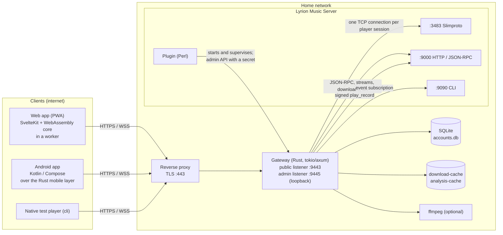

- **Clients** only ever talk HTTPS and secure WebSockets to the reverse proxy. They use one public, versioned API (`/v1`), documented in [`PROTOCOL.md`](PROTOCOL.md). The web app uses no private endpoint, so the native apps can do everything it does.
- **The reverse proxy** terminates TLS and forwards to the gateway only. The gateway refuses plain-HTTP requests from anything but loopback, and believes `X-Forwarded-For` only from proxies it was told to trust.
- **The gateway** is the only process that talks to LMS's Slimproto (3483), HTTP/JSON-RPC (9000) and CLI (9090) ports. Those ports are never forwarded.
- **The plugin** runs inside LMS. It starts the gateway, restarts it if it stops, and manages accounts through the gateway's loopback-only admin API. Accounts live in the gateway's database, not in LMS's prefs (SPEC D12).

Why a separate process rather than doing it all in a plugin (SPEC D2): LMS is a single-threaded Perl event loop. WebSockets, password hashing, audio relaying and transcoding would slow the whole server, and a memory-safe, separately tested process keeps bugs in LMS's own HTTP server unreachable from outside.

## 2. Components

| Component | Language | Responsibilities |
|---|---|---|
| **Gateway** (`gateway/`) | Rust (tokio, axum, rusqlite) | Accounts, sign-in, tokens and two-step; the JSON-RPC allow-list and response scrubbing; the Slimproto tunnel with resume; stream relay, FLAC artwork stripping and live Opus re-encoding; downloads and transcoding; artwork proxy with SSRF checks; events; track analysis; lyrics and artist information; listening history, stats, Home, stations and smart filters; ratings, alarms and checked queue edits; diagnostics; serving the web app; the admin API |
| **Core** (`core/`) | Rust, no I/O | Slimproto parsing and the player state machine; decoding (Symphonia, plus Opus); the lossless FLAC/ALAC-in-fMP4 muxer for media-element playback; the DSP chain; track analysis (R128, waveform); the visualiser's analyser; the LRC lyrics parser |
| **WASM bindings** (`wasm/`) | Rust | `WasmPlayer`, `WasmSegmenter` and `WasmVisualiser`: the core for the browser |
| **Web app** (`web/app/`) | SvelteKit, Svelte 5, TypeScript | The installable PWA: UI, the player worker and AudioWorklet, offline downloads in IndexedDB, the service worker |
| **Mobile layer** (`mobile/`) | Rust, UniFFI | The native apps' host: HTTPS and sign-in, the command API, events, the audio engine and output, downloads and the offline store, transfer planning, the Android Auto browse grammar. Shared by Android and the planned iOS app |
| **Android app** (`apps/android/`) | Kotlin, Jetpack Compose, Media3 | The native UI, the Media3 session, Android Auto, widgets, tile, car mode, settings, secure storage |
| **Plugin** (`plugin/`) | Perl | Gateway supervision, the settings page, `anywhere …` LMS commands, recording offline plays in LMS |
| **CLI** (`cli/`) | Rust | A native test player for the core, directly against LMS or through the gateway |

## 3. Repository layout

| Path | What |
|---|---|
| `core/` | The sans-IO player core: `proto.rs` (Slimproto), `player.rs` (state machine), `decode.rs`, `opus.rs`, `mux.rs` (fMP4 segmenter), `dsp/`, `analysis/`, `visual.rs`, `lyrics.rs`; robustness, bit-perfect and DSP tests in `core/tests/` |
| `gateway/` | The gateway. `src/` has one module per surface (`auth.rs`, `accounts.rs`, `rpc.rs`, `rpc_policy.rs`, `menu_actions.rs`, `tunnel.rs`, `session.rs`, `relay.rs`, `flac_strip.rs`, `live.rs`, `download.rs`, `transcode.rs`, `art.rs`, `events.rs`, `analysis.rs`, `history.rs`, `stats.rs`, `home.rs`, `stations.rs`, `filters.rs`, `ratings.rs`, `alarms.rs`, `queue_edit.rs`, `lyrics.rs`, `info.rs`, `plays.rs`, `diagnostics.rs`, `status_fix.rs`, `limits.rs`, `admin.rs`, `totp.rs`); integration tests against a fake LMS in `gateway/tests/` |
| `wasm/` | WebAssembly bindings for the core |
| `web/app/` | The web app. `src/routes/` (pages), `src/lib/` (API client, player, offline, theme, stations, stats, …), `static/player/` (the player worker, AudioWorklet and helpers) |
| `mobile/` | The native apps' shared Rust layer; `src/player/` is the audio engine, `src/offline/` the download manager and store; integration tests through the real gateway in `mobile/tests/` |
| `apps/android/` | The Android app (modules `:app`, `:ui`, `:data`, `:playback`, `:rust`), store metadata (`fastlane/`) and the F-Droid recipe (`fdroid/`) |
| `plugin/` | The LMS plugin (`Plugins/LyrionAnywhere/`) and its tests (`t/`, with stubbed `Slim::*` modules) |
| `cli/` | Native test player |
| `deploy/` | Example nginx configuration, tested in CI |
| `tools/` | Release and web builds, deployment and release checks, the demo (`tools/demo`: a fake LMS with an invented library), opt-in live tests (`tools/live`) |
| `third_party/` | A patched copy of `opus-decoder`, until a fixed release |
| `docs/` | Installation, deployment, protocol, privacy, performance, releasing, security reviews, design plans |

## 4. Trust boundary and threat model

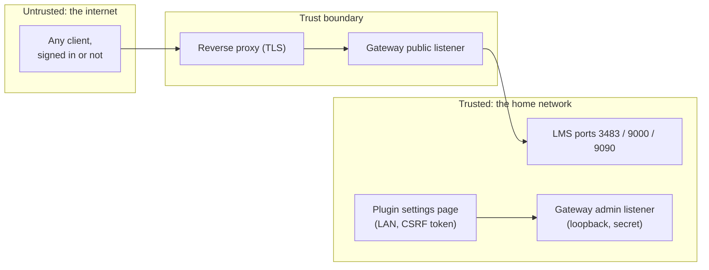

Everything that crosses the boundary goes through the gateway's public listener. The design is **default deny**: a command, path, frame or field is refused unless it is explicitly allowed and its arguments validate.

| Threat | Mitigation |
|---|---|
| Internet scanners hitting LMS's own bugs (path traversal, `readdirectory`, XSS) | LMS ports never exposed; only allow-listed commands and fixed path patterns are forwarded |
| Password guessing | Per-address hard lockout (IPv6 per /64); a per-user soft lockout that refuses the addresses that failed and holds all others to 2 attempts a minute, so nobody can lock a user out; attempts counted before checking; at most 4 password checks at once; optional TOTP; generic errors |
| Stolen device or token | 15-minute access tokens held in memory; refresh tokens rotated on every use with reuse detection; per-device revocation that closes sockets at once |
| Impersonating another player | HELO must carry the device's assigned MAC; the stream path must match the session's own MAC; `serv` redirects dropped |
| Reading arbitrary files | Tracks resolved only by library id; `file:` URLs, paths and local URLs refused in every command and free-text field; responses scrubbed by key and by value |
| Making LMS fetch home-network URLs (SSRF) | Image-proxy URLs only if LMS itself handed them out in an image field; local hosts refused in any spelling; names resolved and checked |
| XSS from hostile tag metadata | Framework escaping; strict CSP with no inline script; metadata never rendered as HTML (enforced by a source-wide test) |
| Resource exhaustion | Caps on connections, sessions, frame and body sizes, event sockets, artwork in flight, downloads, transcodes, analyses and per-user request rates; time limits on every upstream call |
| A LAN web page driving LMS's open JSON-RPC to create remote accounts | Every `anywhere …` admin command needs a per-start CSRF token that only the settings page has; `anywhere` is reserved in the gateway's allow-list |
| A misconfigured proxy | The gateway binds to loopback by default and refuses non-TLS requests from remote addresses |

The full threat model is in [`SPEC.md`](../SPEC.md) §9; the security reviews are in [`security/`](security).

## 5. Request flows

### 5.1 Sign-in and refresh-token rotation

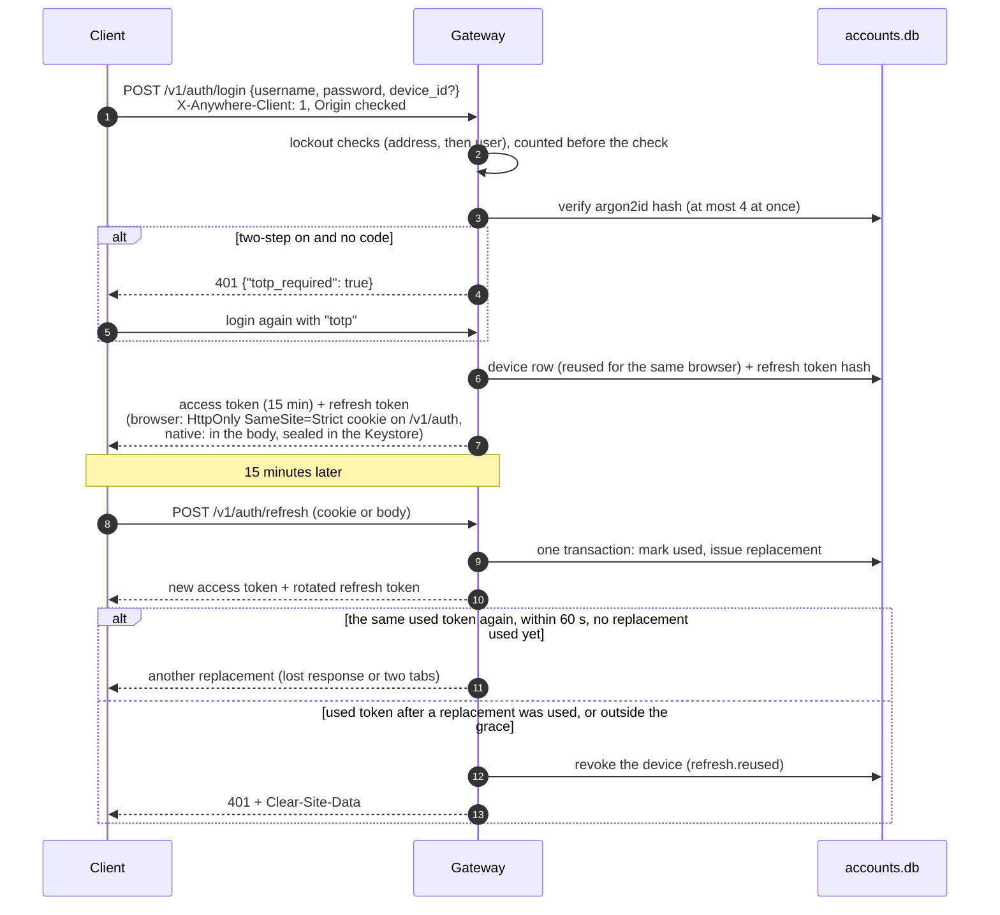

- Access tokens are random, held hashed in the gateway's memory and in the client's memory only; revocation is immediate.
- The 60-second grace and its trade-off are a deliberate decision (SPEC D21): a thief would need the refresh token itself within the window, and whichever side uses its replacement first cuts the other off.
- Clients sign out only when the gateway itself refuses a refresh with its JSON 401. A proxy or CDN error page never ends a sign-in.
- Native apps can also sign in with a one-time **pairing code** (`POST /v1/auth/pair`), shown as a QR code by the plugin (*Add a device*) or by the web app (*Add another device*, which needs the password).

### 5.2 Browse and control: the JSON-RPC allow-list

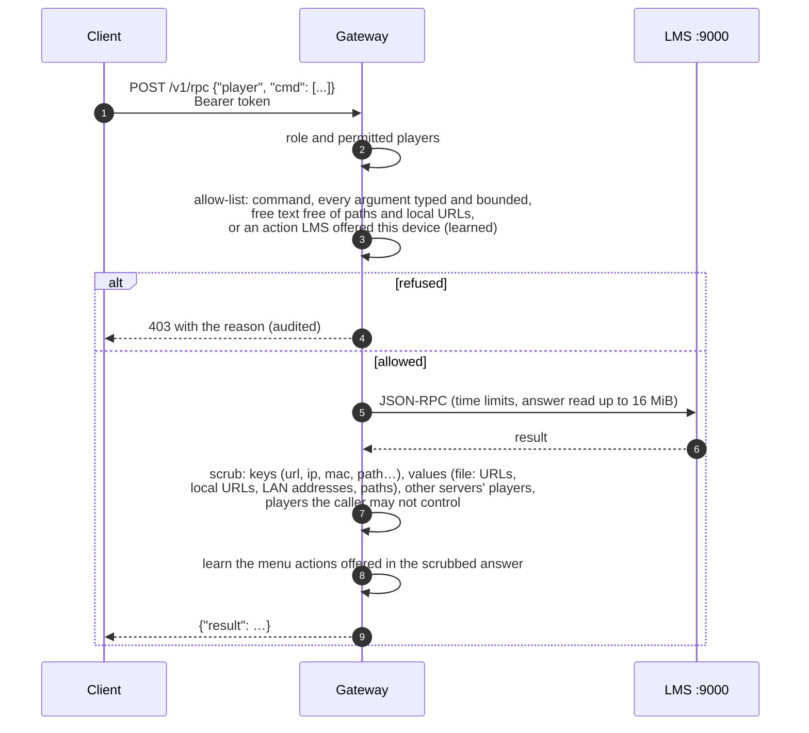

- **Fixed allow-list** (`rpc_policy.rs`): library browsing and search, favourites, apps and radio menus, transport, volume, sleep, sync among permitted players, saved playlists (changes are admin-only), Random Mix through a fixed grammar, Don't Stop The Music's provider setting. Always refused: `readdirectory`, `pref`, `playerpref` (apart from the one setting), restart, logging, display and button commands, and anything taking a URL or file path.
- **Learned actions** (`menu_actions.rs`): plugins define their own commands. A command outside the fixed list runs only if LMS offered exactly that action, word for word, in a menu relayed to the same device in the last hour. Server-level commands never run this way, and actions that change shared data need an admin. This is how AudioMuse-AI, Custom Browse and other plugins work without anything hard-coded.
- **Admin-only plugins:** an admin can reserve a plugin; listeners then never see it, and its commands are refused however they are reached.
- **Typed endpoints** sit beside `/v1/rpc` where the generic path would be unsafe or racy: checked queue edits (`/v1/players/{player}/queue/edit`, which checks the entry before removing or moving it), alarms (sounds by opaque id only), ratings, lyrics and artist information.

### 5.3 The events channel

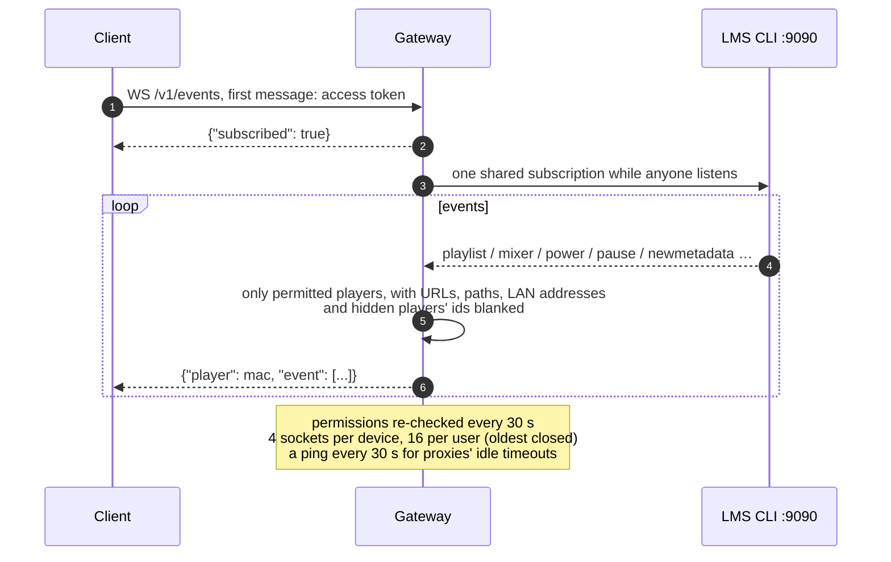

Clients use events as hints to re-read status; they also poll slowly as a fallback. `{"resync": true}` means events were missed.

### 5.4 The player socket: Slimproto over WebSocket

Each device is a real LMS player. Its Slimproto connection is tunnelled through the gateway, which holds the TCP connection to LMS on the device's behalf.

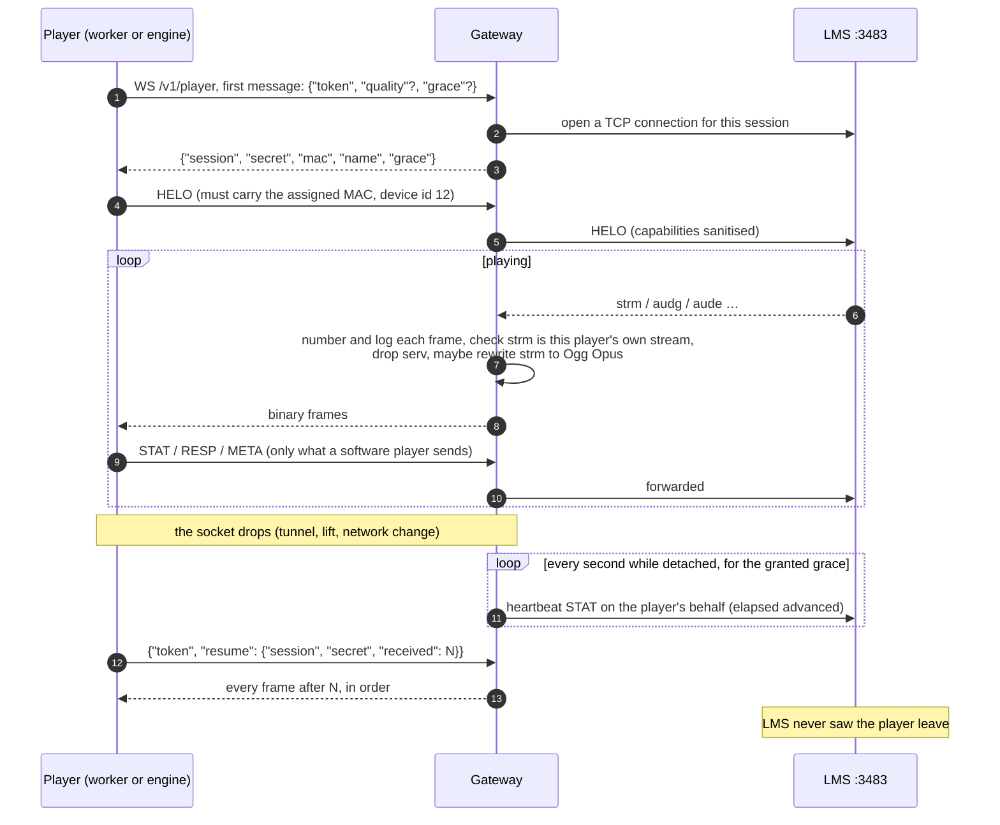

- **Enforcement:** only HELO, STAT, RESP, META, DSCO, `BYE!` and SETD (only as the answer to LMS's name query) reach LMS. IR, BUTN, KNOB, BODY and anything else end the session as a policy violation, as does a second HELO, another MAC, or a frame over 16 KiB.
- **Grace:** 60 s by default. A client may ask for longer at sign-in (`"grace"`), up to `--max-resume-grace` (600 s by default); the Android app asks for 600 s.
- **Dead sockets:** the gateway also sends heartbeats for an attached client that has been silent for 8 s; clients give up on a socket that has brought nothing for 20–25 s and resume.
- **One session per device:** a new session ends the previous one, so LMS never sees two players with one MAC. Revoking the device closes it at once.
- **Synchronised playback:** players report elapsed time as frames *heard* (from the platform's output timestamp), start a synced group at the exact time asked, and apply LMS's pause and skip corrections at the output (SPEC D22; [`PROTOCOL.md`](PROTOCOL.md#synchronised-playback-how-our-players-keep-time)).

### 5.5 Audio streaming

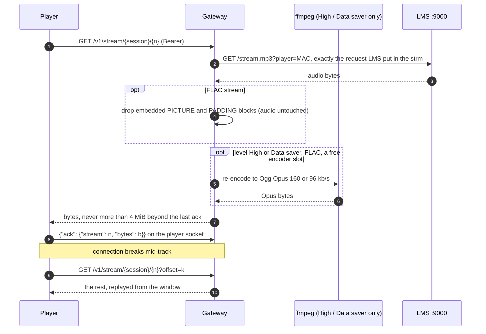

- **Replay window:** the upstream connection belongs to the session, not the HTTP request. The gateway reads at most one window (4 MiB) beyond the client's last acknowledgement, so network buffers can't swallow whole tracks and a resume always lands inside the window.
- **Clean ends mean the end of the track:** a response ends cleanly only when LMS finished the stream and the client has every byte. Every other end is an error, so a player never mistakes a cut for the end of a track.
- **Byte counts:** offsets count the stream as the client receives it (stripped, or Opus). The gateway converts STAT byte counts back into LMS's terms.
- **Live transcode** (SPEC D25): Original, High (Opus 160 kb/s) and Data saver (Opus 96 kb/s). Only FLAC is re-encoded; at most `--live-transcode-jobs` at once, the original beyond that. ffmpeg runs with a fixed argument list, no shell, an empty environment and only the `pipe` protocol, and is killed with its stream.

### 5.6 Downloads

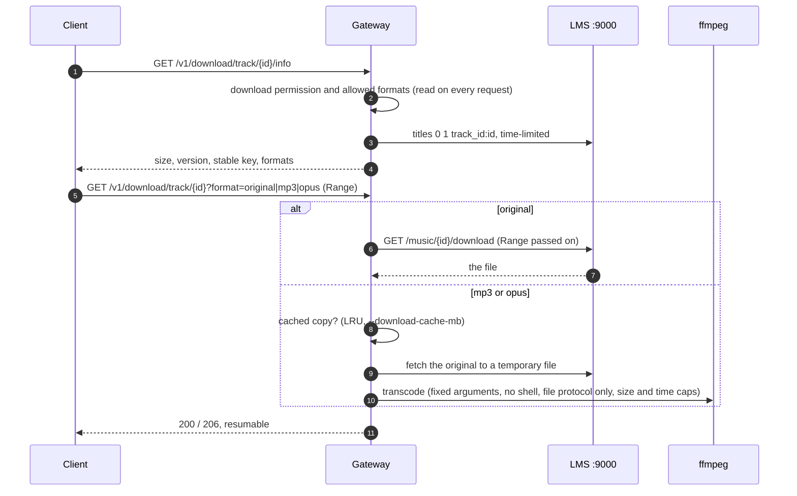

- **Stable keys:** LMS renumbers tracks on a rescan, so downloads, history, ratings and offline plays are keyed by a stable key: a hash of a random gateway secret and the track's library URL. It survives rescans and never reveals the path.
- **Limits:** 3 downloads at once per user; revoking the device ends running downloads within seconds.

### 5.7 Artwork

`GET /v1/art/<path>` relays only fixed patterns: covers by track id, the current cover of a permitted player, plugin and built-in icons, and image-proxy URLs that LMS itself handed out in an image field of a scrubbed answer (or as an artist photo from `/v1/info`). A proxied URL's host must not be local in any spelling, and must not resolve to a local address. Only real images are relayed, streamed with a 20 MiB cap, with a sandboxing CSP; 8 requests in flight per user and 32 in all. Clients fetch art with the bearer token in a header and show it through blob URLs, so credentials never appear in image URLs.

### 5.8 Track analysis and the waveform

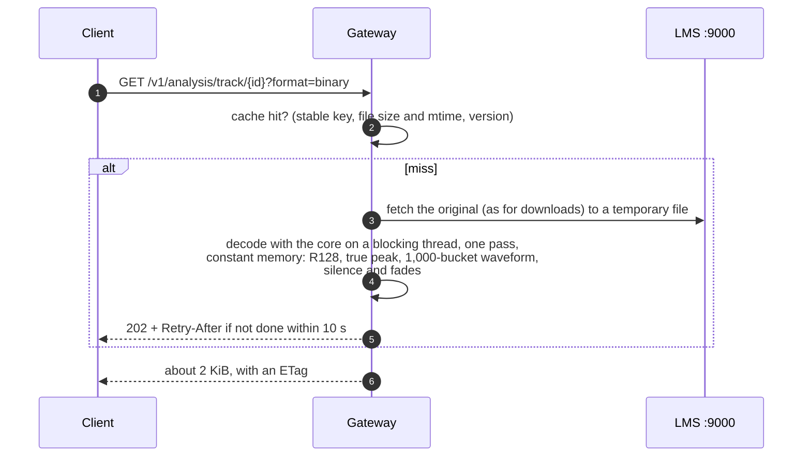

One analysis at a time by default, a queue cap, per-user limits, 1 GiB and 2 h caps, a 5-minute deadline; corrupt files are a clean 422. Results feed the waveform seek bar (web and Android), loudness levelling and smart transitions (Android). `--no-analysis` turns it off; clients then show a plain seek bar and level from ReplayGain tags.

### 5.9 Listening history and stats

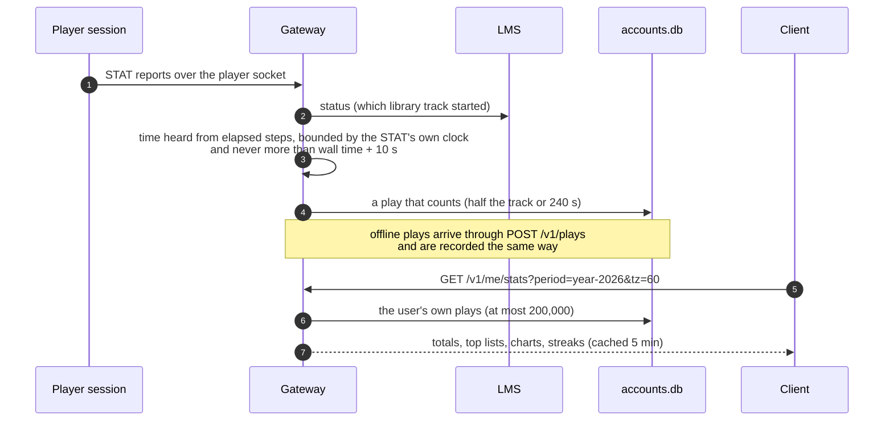

- **Only what the gateway sees itself** (SPEC D23): a session belongs to one device, so to one user; hardware players and other users' devices are never attributed to anyone.
- **Kept 13 months,** at most 50,000 plays per user. Users view, clear or switch it off; nobody else can read it through the apps or the API.
- **Stations** blend the user's own plays (×3) with LMS's server-wide play counts (×1). **Home's history shelves** are the user's own plays only, so no user sees what others played.
- **Offline plays** also go to LMS: the gateway forwards each to the plugin's `anywhere play_record`, signed with HMAC-SHA256 under the shared admin secret, and the plugin raises the play count and sets last played as LMS does for its own players.

### 5.10 Rolling cache and read-ahead (Android)

For a phone streaming over patchy mobile data (design: [`plans/wave3-design.md`](plans/wave3-design.md) §2).

**Phase A, built:**
- **Disk spool:** each live stream is written to an app-private file as fast as the network allows (at most 256 MiB per stream, 512 MiB in all; in memory beyond that) and fed to the decoder as it wants it.
- **Read-ahead:** a track is reported ready (`STMd`) once it is fully received, so LMS sends the next one long before the current one ends. A gap in the signal is covered by the rest of the current track plus the whole next one. On by default, including on mobile data; switches in *Settings › Playback on this phone › Gaps in the signal*.
- **Longer grace:** the phone asks for 600 s and the gateway grants up to `--max-resume-grace`; while detached, the phone keeps its status reports in an outbox that drops heartbeats first.
- **After a gap longer than the grace:** the new session restarts the track heard last at the point last heard, after checking with LMS that it is still at that queue position and that nobody has started or paused anything since.
- **The cushion:** the signal path and *Play on…* show how much listening is held on the phone.
- **History stays honest:** the gateway judges elapsed steps by the player's own clock, so reports queued during a gap and sent together count for what was really heard, and never more than wall time allows.

**Phase B, built (replay cache):**
- **Store:** cleanly finished spools move into a bounded LRU cache on the phone (`mobile/src/player/cache.rs`; Off, 500 MB, 1 GB by default, 2 GB or 5 GB). Files are named by hash only, with a strictly validated index; entries in use are never evicted.
- **Permission:** the cache is used only while the user has the download permission (`/v1/account`), and is emptied when it is lost, on sign-out, on revocation and on *Clear*.
- **Matching:** a new stream is fingerprinted on its header plus 64 KiB. When the cache may hold it, the phone first asks the gateway for only a short probe (`/v1/stream/…?limit=`). On a hit, the whole file's length and SHA-256 are checked before the rest is played from it, and checked again at the end; any doubt means the network. A replay costs about 98 KiB instead of the whole track, and the signal path says *From cache*.
- **Deterministic Opus:** the gateway encodes live Opus bit-exactly, so the same track at the same level gives the same bytes and can be matched.
- **Honest byte counts:** the relay caps the byte count it reports to LMS at what it actually sent.

**Phase C, built (downloaded originals):**
- **When:** an Original-level FLAC stream while the phone holds Original FLAC downloads. The stream starts with a short probe.
- **Matching:** the stream's STREAMINFO must equal a download's in full (audio MD5, sample count, rate, channels, depth); an unset MD5 never matches.
- **Checks:** the download must pass the offline store's own file checks, the audio already received must equal the file's bytes at the same point, and the whole file must decode to its STREAMINFO MD5 (checked once per file version). Any failure means the network.
- **Splice:** the rest of the stream is fed from the downloaded file at the first audio frame, so the decoded audio is bit-identical; the signal path says *From downloads*.

## 6. The sans-IO core and its hosts

`core/` does no I/O (a project rule). A host feeds it control and stream bytes, carries out the `Action`s it emits (open a stream, send a frame, start output), and pulls PCM. That keeps the protocol and audio logic identical, and testable, on every platform.

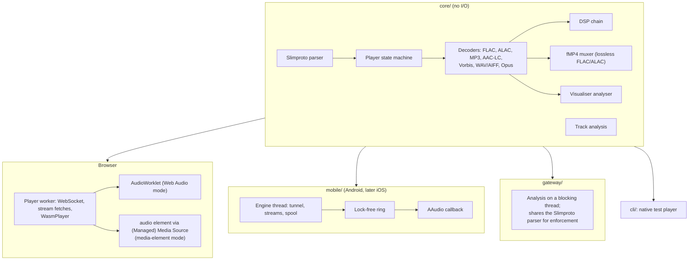

### 6.1 The browser player

- **The worker** (`web/app/static/player/player-worker.js`) runs the WebAssembly core, owns the player socket and stream fetches, resumes after drops and acknowledges stream bytes. Only one tab per browser runs the player (a Web Lock); others control it.
- **Two output modes, chosen automatically** after a self-test of what the browser really plays:
  - **Web Audio:** PCM goes to an AudioWorklet with about 0.3 s queued, for low latency. Used on desktops.
  - **Media element:** decoded audio is re-wrapped losslessly (FLAC verbatim frames, or ALAC as a last resort, in fragmented MP4) and fed to an `<audio>` element through Managed Media Source (iOS 17.1+) or Media Source, about 8 s ahead. Phones keep a playing media element running with the screen locked. Used on iPhone, iPad and Android. If it fails, the player falls back to Web Audio by itself.
- **Volume:** LMS's volume is applied at the output, after queued audio, ramped over 30 ms. Where a page can't set the volume (iPhone, iPad), the device plays at full scale and LMS's volume is held at 100 %.
- **Seeks and quick start:** queued audio is dropped on the flush itself; playback starts once 0.5 s is decoded when the stream arrives at least twice as fast as it plays.
- **The visualiser** taps the PCM being played, only while shown, and releases frames as their audio is heard (at most 30 a second).
- **Offline:** downloads are stored in IndexedDB in about 1 MiB pieces, per user, and played through a separate `<audio>` element; the service worker caches the app shell only, never API answers, audio or art.

### 6.2 The native CLI

`cli/` is a native player built on the same core, used in the Phase 0 spike and for testing against a real LMS, directly or through the gateway (`--gateway`, signing in as a user).

### 6.3 The mobile engine (UniFFI)

`mobile/` is the native host, shared by Android and the planned iOS app. Kotlin (and later Swift) calls it as `suspend` functions through UniFFI.

- **Network:** HTTPS with rustls and the platform's own certificate verifier (no bundled CA list); single-flight token refresh; the allow-listed commands with typed builders; artwork with the token in a header; an events stream that reconnects by itself.
- **The engine** (`mobile/src/player`): the Slimproto tunnel with resume, stream downloads with byte-offset resume and the disk spool, the core's decoders, the DSP pipeline, and a lock-free ring buffer read by the output callback, which neither allocates nor locks. On Android the output is AAudio driven from Rust, opened at each track's sample rate.
- **Two playback sources, one engine** (SPEC D14): the phone as an LMS player when online, and a local queue of downloads offline. Both get the same DSP, levelling, bit-perfect output and signal path.
- **Also:** the download manager and offline index, the offline plays queue, transfer planning, station refills, the Android Auto id grammar, crash-report redaction.

## 7. The Android app

### 7.1 Modules

| Module | Contents |
|---|---|
| `:app` | Application, manual dependency injection (`AppContainer`), navigation, the widgets and Quick Settings tile, the download foreground service |
| `:ui` | Design system, screens and view models (Compose, Material 3): library, player, queue, rooms, stats, settings, car mode, onboarding and QR scanning |
| `:playback` | The Media3 `MediaLibraryService`: a `SimpleBasePlayer` over LMS and one over the offline queue, audio focus, becoming noisy, wake and Wi-Fi locks, USB DAC handling, Android Auto's browse tree, caller checks and artwork provider |
| `:data` | Repositories over the Rust layer, typed errors, settings, the Keystore-sealed sign-in, downloads and offline mode |
| `:rust` | Builds `libanywhere_mobile.so` with `cargo-ndk` and generates the UniFFI Kotlin bindings |

### 7.2 Playback

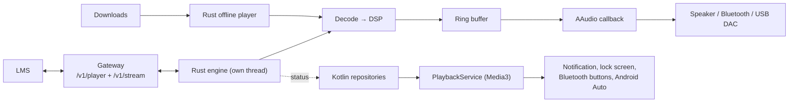

- **Media3 session:** wraps LMS's state for this phone's player (or the offline queue) so the notification, lock screen, Bluetooth and headset buttons and Android Auto drive it. The service is exported for Android Auto, so every caller is checked: Android Auto and the Google assistants only with their pinned release certificates; system controllers; transport-only for other trusted controllers; everyone else refused.
- **Output and DSP chain:** preamp and loudness levelling, parametric EQ (per output), loudness-compensated volume, crossfeed, a true-peak limiter, and dither only where bit depth is reduced; crossfades and smart transitions when enabled. Everything is off by default, so playback is bit-perfect.
- **Bit-perfect USB** (Android 14+): with a DAC that offers it, the app sets Android's bit-perfect mixer attributes for the track's rate and depth and the engine plays in that integer format. Volume is then fixed at 100 % and the DAC's own volume sets the level (SPEC D19). The signal path claims "bit-perfect" only when that really holds, and otherwise says why not.
- **Sign-in storage:** the refresh token is sealed with AES-256-GCM under a non-exportable Android Keystore key; backups are off; release builds allow no cleartext and trust only system certificates.
- **No start-up initialisers:** downloads run in a `dataSync` foreground service only while busy. WorkManager's initialiser crashed earlier test builds and stays removed (see [`RELEASING.md`](RELEASING.md)).

## 8. The LMS plugin

`Plugins::LyrionAnywhere` (LMS 9.0+) has three jobs.

- **Lifecycle and supervision** (`Gateway.pm`):
  - picks the bundled gateway for the platform (x86_64, aarch64 or armhf Linux) and runs it only if it matches `Bin/SHA256SUMS`, directly, without a shell;
  - restarts it with backoff (5 s doubling to 5 minutes), stops it without blocking LMS (SIGTERM, then SIGKILL after 5 s), and after an LMS crash stops a leftover gateway only when `/proc/<pid>/cmdline` shows it is ours;
  - sends the admin secret only to the gateway it started, on the port it started it with;
  - a development gateway path is honoured only when LMS runs with `ANYWHERE_ALLOW_GATEWAY_PATH=1`.
- **Settings page** (`Settings.pm`, `HTML/`): gateway options (listen address, public URL, trusted proxies, client address header, transcoding, ffmpeg path, download cache, track analysis), users and roles, player grants, download permissions, two-step resets, *Add a device* QR codes, the sign-in lifetime, admin-only plugins, the device list with diagnostics and renames, and recent activity. Everything is rendered as text, and saving needs the page's own token.
- **LMS commands** (`Commands.pm`): `anywhere …` commands for every admin operation, each needing a CSRF token made when LMS starts and given only to the settings page (only `anywhere status` needs none); and `anywhere play_record`, which the gateway calls, signed, to count offline plays. Remote users can never reach these: `anywhere` is reserved in the gateway's allow-list.

The plugin stores no account data itself. Its own state (the gateway's data directory, `lyrion-anywhere` under LMS's prefs folder, and its prefs) lives with LMS's prefs.

## 9. Data storage

### 9.1 On the gateway

In its data directory (`<LMS prefs>/lyrion-anywhere/` under the plugin, `/data` in Docker):

| Store | Contents | Retention |
|---|---|---|
| `accounts.db` (SQLite, migrations tracked with `PRAGMA user_version`) | Users (argon2id hashes, roles, TOTP secrets, download permissions, player grants); devices (name, assigned MAC, client kind, platform, User-Agent, last address); refresh-token and pairing-code hashes; settings | Until deleted. A revoked device's address and User-Agent are erased at once; the row is deleted after 30 days |
| | Audit log | One year, at most 100,000 entries |
| | Offline play keys (deduplication) | 91 days, at most 50,000 per user |
| | Listening history | 13 months, at most 50,000 plays per user |
| | Ratings, Home layout, stations, pinned menus, smart filters | Until changed or deleted; all deleted with the user |
| | Latest diagnostics report per device | Deleted with the device |
| `admin.secret` (mode 0600) | The admin API secret | |
| `download-cache/` | Transcoded downloads | LRU, 2 GiB by default |
| `analysis-cache/` | Track analyses (about 2 KiB each) | LRU, 64 MiB by default |
| In memory only | Access tokens (hashed), learned menu actions (an hour), lyrics (15 min), artist information (24 h, 1 h when empty), stats answers (5 min) | |

[`PRIVACY.md`](PRIVACY.md) lists the same from the user's side.

### 9.2 On the clients

- **Web app:** IndexedDB for downloads, their metadata and covers, and queued offline plays, partitioned per user; local storage for per-device preferences. No credentials outside the HttpOnly refresh cookie.
- **Android:** app-private storage that is never backed up: the sealed sign-in, settings, downloads under a folder named by a hash of server and user (files named by stable key), the stream spool (`stream-cache`, deleted at sign-out, revocation and change of user), offline plays, and redacted crash reports that never leave the phone unless the user shares them.

## 10. Configuration

The gateway is configured with command-line flags; the plugin sets them from its settings page. The main ones:

| Flag | Default | Purpose |
|---|---|---|
| `--listen` / `--admin-listen` | `127.0.0.1:9443` / `127.0.0.1:9445` | Public and admin listeners |
| `--data-dir` | | The database, secret and caches |
| `--lms` and port flags | `127.0.0.1`, 3483 / 9000 / 9090 | Where LMS is |
| `--allowed-origin`, `--trusted-proxy`, `--client-ip-header` | | The public URL, proxies to believe, a CDN's client address header |
| `--ffmpeg`, `--no-transcode`, `--download-cache-mb` | `ffmpeg` on `PATH`, 2048 | Transcoded downloads |
| `--live-transcode-jobs` | 4 | Live Opus re-encodes at once (0 turns them off) |
| `--no-analysis`, `--analysis-cache-mb` | 64 | Track analysis |
| `--keep-flac-pictures` | | Don't strip embedded FLAC artwork from streams |
| `--max-connections` | 1024 | Open client connections |
| `--max-resume-grace` | 600 | The longest resume grace a player may ask for, in seconds |
| `--static-dir`, `--log-file` | | The web app to serve; a log file instead of standard output |

The full list, with ranges, is in [`INSTALL.md`](INSTALL.md#option-b-docker).

## 11. Testing strategy

Every change ships with tests for security, stability and reliability, security first ([`CLAUDE.md`](../CLAUDE.md), SPEC §13). CI runs everything on every push.

| Layer | What is tested |
|---|---|
| **Core** | Unit tests for the state machine and framing; robustness tests over random, truncated, mutated and oversize input for the Slimproto parser, decoders, muxer, lyrics parser and analysis (they must never panic or allocate without bound); bit-exactness of decoding, the muxer and the DSP when bypassed; DSP and limiter accuracy; analysis against reference values |
| **Gateway** | Negative tests for every endpoint: missing, expired, forged and revoked tokens; wrong-MAC HELO; forged stream paths; `serv`; every denied command; `file:` and local URLs in every spelling; traversal in art and download paths; oversize frames and bodies; rate limits; CSRF and Origin; spoofed forwarding headers. Fuzz-style tests on parsers and policies. Integration tests against a fake LMS (Slimproto, HTTP and CLI): resume within the grace, heartbeats, timeouts, LMS restarts, downloads, analysis, history, stats. Mutation checks confirm protections fail their tests when removed |
| **Contract** | Every command the web app can send is pinned in `web/app/tests/fixtures/commands.json` and run through the real gateway policy; the plugin's contract test drives the real gateway binary |
| **Mobile layer** | Unit and robustness tests, and integration tests through the real gateway: the player end to end (gapless, bit-perfect FLAC, rate changes, resumed disconnects, token expiry), downloads with every failure, transfer, sync accuracy in a simulated group (`mobile/tests/sync.rs`), read-ahead and long gaps |
| **Web app** | Strict type check; Vitest component tests with hostile metadata; Node tests for the worker, worklet and CSS budgets (no page scroll, 44 px targets); a source-wide ban on `{@html}`, `innerHTML` and `eval`; the build fails on any inline script; contrast tests for every theme, mode and accent |
| **Android** | JVM and Robolectric tests for view models, screens and gestures; accessibility audits of every screen and state; manifest checks (what is exported, intent filters, no start-up initialisers); lint with no baseline |
| **Plugin** | `prove` tests against stubbed `Slim::*` modules (validation, CSRF tokens, supervision, signed play records) and Node tests for the settings page |
| **Deployment** | `tools/test-deploy.sh` runs the Docker image behind the example nginx configuration (TLS redirect, a single CSP, LMS and admin paths unreachable, cookie flags, lockouts that hold against spoofed `X-Forwarded-For`); `tools/test-release.sh` checks the plugin zip |
| **Supply chain** | `cargo deny` (licences, advisories, bans, sources); actions pinned to commit SHAs and base images to digests |
| **Live (opt-in)** | Against a real LMS with a dedicated, muted test player, configured from git-ignored `dev/local.*` files; spikes such as `tools/live/lms_read_ahead.py` |

Security fixes get a regression test that fails before the fix. Nothing is called done while any test fails or is skipped.

## 12. Performance

- **Gateway:** aimed at small LMS hosts: it targets under 50 MB resident when idle, transcoding limited so ffmpeg can't starve LMS, one analysis at a time, streamed rather than buffered artwork, and FLAC artwork stripped so playback starts sooner (in tests, bytes before the first half-second of audio fell from 704 KiB to 224 KiB).
- **Android:** budgets for start-up, scrolling, memory, battery, audio underruns and APK size, and how to measure them, are in [`PERFORMANCE.md`](PERFORMANCE.md). The audio thread never waits on the UI.
