# Features

Everything Lyrion Anywhere does, grouped by area. Each feature says where it runs:

- **Both:** the web app (in any modern browser, or installed as an app) and the Android app;
- **Web:** the web app only;
- **Android:** the Android app only;
- **Server:** the gateway or the LMS plugin, for every client.

An iOS app is planned on the same shared layer; it isn't listed here until it exists. How things work underneath is in [`ARCHITECTURE.md`](ARCHITECTURE.md); the API is in [`PROTOCOL.md`](PROTOCOL.md).

> Screenshots come from the built-in demo and the Android app's screenshot tests. The library, players, people and artwork are invented.

**Contents**

- [Highlights](#highlights): the short version, for the browser and for Android
- Every feature, by area:

| Area | In short |
|---|---|
| [Playback](#playback) | The device is a real LMS player; lossless and gapless; background playback; resume after dropouts and reloads; sleep timer; lower-data streams on mobile data; in step with the other players in a sync group |
| [Players, rooms and sync](#players-rooms-and-sync) | *Play on…*, move playback between players, sync groups (*Sync with…*), Rooms, alarms |
| [Library and browsing](#library-and-browsing) | All of LMS's "My Music", virtual libraries, credits, A–Z scroller, smart filters, apps, radio and plugins |
| [Search](#search) | Grouped results, recent searches, search inside apps |
| [Queue](#queue) | Sections, drag, swipe, Undo, checked edits, album-aware shuffle, save as a playlist, marks for tracks on this device |
| [Now playing](#now-playing-lyrics-visualiser-and-signal-path) | Waveform seek bar, lyrics, info, visualiser, quality badge and signal path, ratings |
| [Sound](#sound-and-dsp) | Bit-perfect output, levelling, EQ, loudness, crossfeed, dither, transitions (Android) |
| [Discovery](#discovery-and-radio) | Home shelves, stations, Start radio, More like this |
| [Offline](#offline-and-downloads) | Downloads in three formats, offline mode, plays synced back, controls that keep working while the server is out of reach |
| [Your listening](#listening-history-stats-and-your-year) | Private listening history, stats, "Your year in sound" |
| [Car and system](#car-android-auto-widgets-and-system-surfaces) | Car mode, Android Auto, widgets, tile, shortcuts, haptics, Media Session |
| [Appearance and accessibility](#appearance-and-accessibility) | Material, Classic and High contrast themes; tested contrast; screen readers and keyboards |
| [Accounts and admin](#accounts-devices-roles-and-admin) | Per-user accounts, roles, player grants, QR pairing, change your own password, Your devices, diagnostics |
| [Security](#security-features) and [privacy](#privacy-controls) | Enforced by the gateway for every client; the summary is in [`SECURITY.md`](SECURITY.md) |
| [Installation](#installation-and-the-installable-app) | The plugin, Docker, a tested proxy configuration, the installable web app, Android releases, the demo |

---

## Highlights

### Made for LMS, with every device a real player

- **Every device is a real player.** Your phone or browser appears in LMS as a Squeezebox-style player, so gapless playback, sync groups, alarms, plugins and play counts all work as they do on any LMS player. It is not a remote control that needs another speaker.
- **In step with the players at home.** In a sync group, the phone or browser reports what is actually heard and applies LMS's corrections at the output, so it plays in step with Squeezeboxes and other players. In the browser's media-element mode (Safari, and any browser playing in the background) the corrections are made in the audio itself. After a dropped connection a phone rejoins in step without pausing the rest of the group (see [Players, rooms and sync](#players-rooms-and-sync) and SPEC D22).
- **Lossless where it matters, frugal where it counts.** FLAC plays as FLAC. On mobile data the gateway can re-encode to Opus on the fly, and offline downloads can be the original files or smaller copies.
- **Honest when the server is away.** If your server can't be reached, controls that can't work are greyed out, while the ones that can keep working on the device: pause, resume, and skipping to tracks it already holds. A server that is merely busy (say, its music drive spinning up) is shown calmly as busy, not offline.
- **Made for LMS.** Apps, radio and plugins (AudioMuse-AI, Custom Browse, podcasts, streaming services and more) appear by themselves, with nothing hard-coded.
- **For households:** each person has their own account, with their own devices, history and settings. Guests can be limited to the players you choose.

### In the browser (installable web app)

  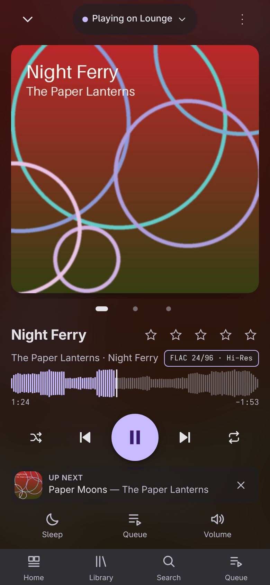

- **Plays on the device straight away:** sign in and press Play. Lossless decoding runs in WebAssembly; on iPhone, iPad and Android it keeps playing with the screen locked.
- **Uncluttered:** one row of Library sections, Play · Shuffle · Download · ⋯ on every album and playlist, one ⋯ per row, one status line at the top, and Settings in seven short sections.
- **Your whole library:** albums (including recently added and random), artists by role, playlists, favourites, smart playlists, genres, years, compilations, folders, downloads, and every app and radio service LMS offers.
- **Now playing that earns its space:** waveform seek bar, synced lyrics, artist biographies, a visualiser, a quality badge that opens the signal path, and a sleep timer.
- **Your own Home, stations and listening stats,** including a "Your year in sound" story you can share as an image made on the device.
- **Play on… and Rooms:** every player and what it is playing; move playback, join or leave sync groups (*Sync with…*), switch players on or off and set their alarms. On a wide screen Rooms shows them as cards: drag one cover onto another to sync them.
- **Downloads:** albums, playlists, artists and tracks for offline listening, with a storage limit and an optional Wi-Fi only setting; they play through the normal player screens.

### On Android (native app)

  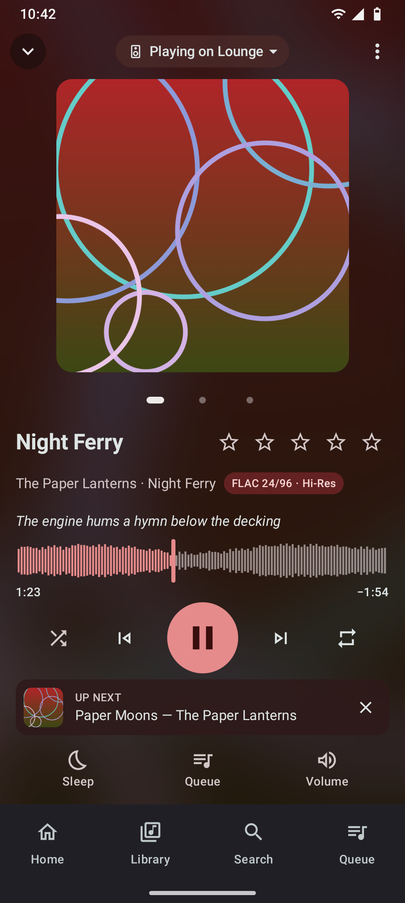

- **Bit-perfect audio:** a Rust engine with AAudio output, bit-perfect by default, and bit-perfect to a USB DAC on Android 14 and later where the DAC supports it.
- **Optional DSP, all off by default:** loudness levelling (ReplayGain or the server's EBU R128 analysis), parametric EQ with AutoEq import and per-output profiles, loudness-compensated volume, crossfeed, dither, and smart crossfades that never cross into a gapless album.
- **Android Auto, car mode, widgets, a Quick Settings tile and app shortcuts.**
- **Offline:** downloads (including smart downloads of recent albums and favourites), an offline mode, plays counted in LMS when you are back online, and *Continue on…* any player where you left off.
- **Gaps in the signal** (Android app): the next track is fetched long before the current one ends, and a session survives up to ten minutes without a connection. A replay cache plays repeats and skips back from the phone, and an album downloaded as FLAC stands in for Original-quality streams. In a browser, only the current track is held: it plays to its end and the gateway keeps the player's place for up to ten minutes, but the next track needs the server. A multi-track cache for browsers is a possible later improvement (GitHub issue #13).
- **Out of reach, not out of action:** while the server can't be reached, the phone keeps playing, pausing and skipping between tracks it holds; the queue marks which tracks are on the phone, and what you did is passed back when the server returns.
- **Layouts for phones, tablets and foldables.**

Where to get the app, and which browsers and Android versions are supported, is in [`PLATFORMS.md`](PLATFORMS.md).

---

## Playback

  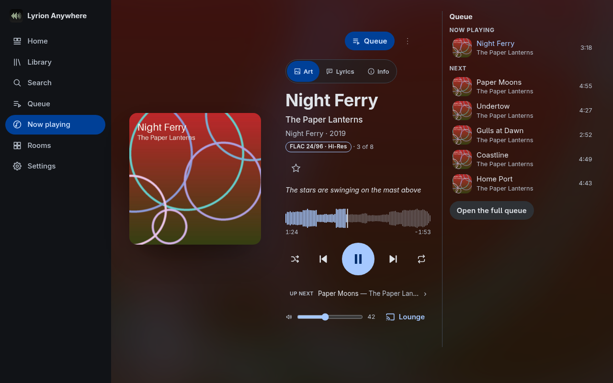

| Feature | Where | Details |
|---|---|---|
| **This device is a real LMS player** | Both | After sign-in the device appears in LMS as a player of its own (named after the device), with gapless playback, sync groups, alarms and plugins working as on any player. It is the default player; the first tap on Play starts the music right there |
| **Default player setting** | Both | When the app opens, play on *this device* (default), *the player used last*, or a named player (for example a desktop beside a hi-fi) |
| **Lossless decoding on the device** | Both | FLAC, ALAC, WAV/AIFF, MP3, AAC, Ogg Vorbis and Opus, decoded by the Rust core (WebAssembly in the browser) |
| **Two browser playback modes, chosen automatically** | Web | *Web Audio* (an AudioWorklet, lowest latency, used on desktops) or *media element* (lossless FLAC, or ALAC as a last resort, in fragmented MP4 through Media Source), which keeps playing with the screen locked on phones. A one-off self-test checks what the browser really plays; *Settings › About › Advanced* shows the mode in use and why, and can override it |
| **Native audio output** | Android | A Rust engine with AAudio output opened at each track's sample rate; bit-perfect by default (see [Sound and DSP](#sound-and-dsp)) |
| **Background playback and media controls** | Both | Lock screen, notification, Bluetooth and headset buttons (Media Session on the web, a Media3 session on Android); audio focus, ducking and "becoming noisy" on Android |
| **Survives network dropouts** | Both | The gateway holds the player's session while the connection is down and keeps LMS believing the player is there, so playback resumes where it was. 60 s by default; up to 10 minutes on Android |
| **Read-ahead for gaps in the signal** | Android | The next track is fetched to the phone long before the current one ends, so tunnels and dead spots don't stop the music. On by default (also on mobile data), in *Settings › Playback on this phone › Gaps in the signal* (web) or *Settings › About › Advanced* (Android). The signal path and *Play on…* show how much listening is held ("4 min buffered ahead") |
| **Replay cache** | Android | Tracks streamed in full are kept on the phone, so a replay or a skip back plays from it after checking a hash of the whole file, using almost no data; the signal path says *From cache*. Off, 500 MB, 1 GB (default), 2 GB or 5 GB, with a *Clear* button, in *Settings › About › Advanced*. Needs the download permission, and is emptied on sign-out or when the permission is removed |
| **Streams from your downloads** | Android | At Original quality, a FLAC stream of an album you've downloaded plays from the downloaded file once its audio is proven identical (STREAMINFO and a full MD5 check), so it costs only a short probe of data. The signal path says *From downloads* |
| **Restart after a long gap** | Android | If the connection was gone longer than the grace, the phone restarts the track heard last at the point last heard, once LMS confirms nothing else has changed |
| **Carry on after a reload** | Web | Reload the page and this device carries on with the same track at the same time. Browsers need a tap before sound: a banner says so |
| **One player per browser** | Web | Only one tab runs the player; other tabs control it |
| **Streaming quality** | Both | *Original*, *High* (Opus 160 kb/s, about 70 MB an hour) or *Data saver* (Opus 96 kb/s, about 45 MB an hour), re-encoded by the gateway from FLAC on the fly. Android: one level for Wi-Fi (Original) and one for mobile data (High). Web: *Automatic* where the browser reports its connection (Chrome on Android), or a fixed level; Firefox and Safari can't report the network, so there *Automatic* means Original and the setting says so. The quality badge and the signal path name the stream actually heard ("Opus 160"; "Opus 160 kb/s, re-encoded by the gateway for the High setting"; Opus is always 48 kHz), not just the track's format in the library. Needs `ffmpeg` on the server |
| **Fast starts and seeks** | Both | Playback starts once half a second is decoded when the stream arrives quickly; embedded FLAC artwork is stripped from streams so the first audio arrives sooner |
| **Volume on this device** | Web | LMS's volume is applied on the device, so any controller changes what you hear. On iPhone and iPad, where a page can't set the volume, the device's own buttons set it and LMS's volume is held at 100 %. *Automatic*, *Follow LMS volume* or *Device buttons only* |
| **Volume on the phone** | Android | Now playing's volume sets Android's media volume while the phone is the player (as the hardware keys do); LMS's own level for the phone is under *Settings › Sound › Player level* |
| **Sleep timer** | Both | 15–90 minutes, a custom length (up to a day), or the end of this track, album or queue; for one player, its sync group or every player you may control. Set as LMS's own sleep, so it works on hardware players and with the app closed. This device fades out first, over a length you choose (off to 2 minutes, 30 s by default) |
| **Synchronised playback** | Both | In a sync group, the phone or browser reports what is actually heard (allowing for output and Bluetooth latency) and starts and corrects at the output, so it stays in step with hardware players. In the browser's media-element mode (Safari, and any browser playing in the background) LMS's skips and pauses are made in the decoded audio, dropping audio or inserting silence, and registered at once, so the element never seeks or stalls (2026-10-15). A member rejoining after a gap gets back in step itself: it skips what the others played, or has LMS restart the group at the group's own position, and never sends LMS the stale underrun report held through the gap, so the rest of the group plays on (SPEC D22). Android's signal path shows the output clock in use and its latency |
| **Seek by tapping** | Both | Tapping the seek bar of a paused track plays from there |

## Players, rooms and sync

  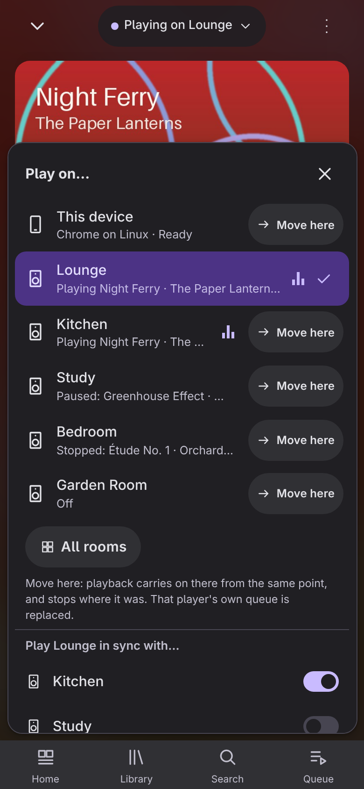
  &nbsp;
  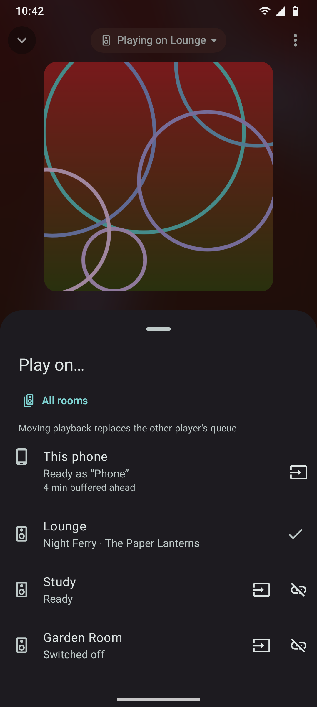

  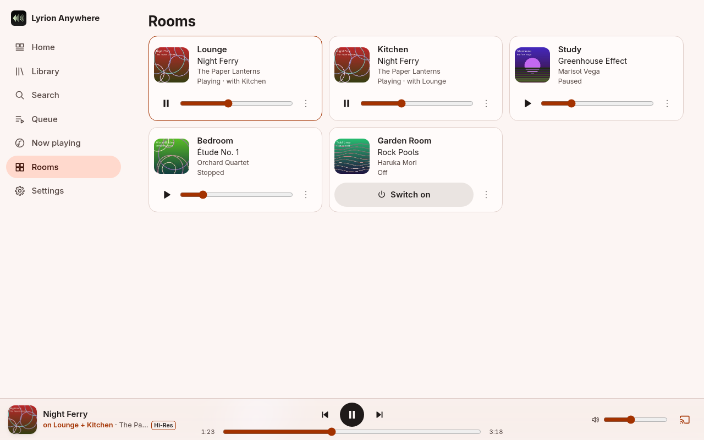

| Feature | Where | Details |
|---|---|---|
| **Play on…** | Both | A small output button opens a sheet listing this device and every other player you may control, with what each is playing. A tap on a row plays on (controls) that player; *Move playback to …* is in the row's ⋮/⋯; grouping is in the sheet too (see *Sync groups*); a grouped player says who it plays with. Long-press the mini player to open it too. Web phones: it also holds the volume of the player in use |
| **Which player is in use** | Both | The mini player names it ("on Lounge"; Android with a speaker); there is no separate strip (Wave 3.5). Going back to this device, or moving playback here, is in *Play on…*. On the web the one status line says when playback is moving |
| **Move playback** | Both | *Move playback to …*, in a player's ⋮/⋯ in Play on…, carries the queue, track, position, shuffle and repeat to that player (or to this device) and stops it where it was; radio and app streams move too. Same recipe on every client (see [`PROTOCOL.md`](PROTOCOL.md#transfer-move-playback-between-players)) |
| **Sync groups** | Both | The mini player names the group ("on Lounge + Study"). In *Play on…* (web and Android, 2026-10-15), an indented row under the controlled player reads *Sync with…*, or "In sync with Study" when grouped; it opens a picker of every other player you may control, a group shown once ("Lounge + Kitchen") and the player's own group first and marked, and the controlled player joins the one chosen (and plays what it plays), or *Leave the group*. Each other player's ⋮/⋯ has *Join its group* (*Leave the group* when it already plays with this one). Greyed out, saying why, while the server is out of reach or busy. The other way round, *Bring players into step with Lounge…* (once *Group players…*) brings other players into, or takes them out of, the controlled player's group. Joining sends `<chosen> sync <controlled>`, which is how LMS reads the command: the argument joins the subject's group |
| **Rooms** | Both | Every player you may control as a card: artwork, track, sleep time left and the next alarm, with play/pause, volume and ⋮/⋯ (power, *Sync with…*, *Play on its own*, moving playback there, alarms). Tap to control; drag a card by its cover onto another to sync (or *Sync with…*, or TalkBack). Wave 3.5: on phones Rooms is part of *Play on…* (each player's ⋮/⋯ plays or pauses, moves playback, opens alarms and switches the player on or off; Android: the controlled and playing players have a volume slider); the Rooms page is the expanded view on large windows |
| **Alarms** | Both | LMS's own alarms for any player you may control: time, days, once or weekly, what to play (the current queue, favourites, playlists, random mixes or sounds), shuffle and volume; an on/off switch per alarm and for all of a player's alarms. They ring on hardware players with no app open |
| **Player permissions** | Server | Listeners see and control only their own devices and the home players an admin granted them; admins control every player |

## Library and browsing

  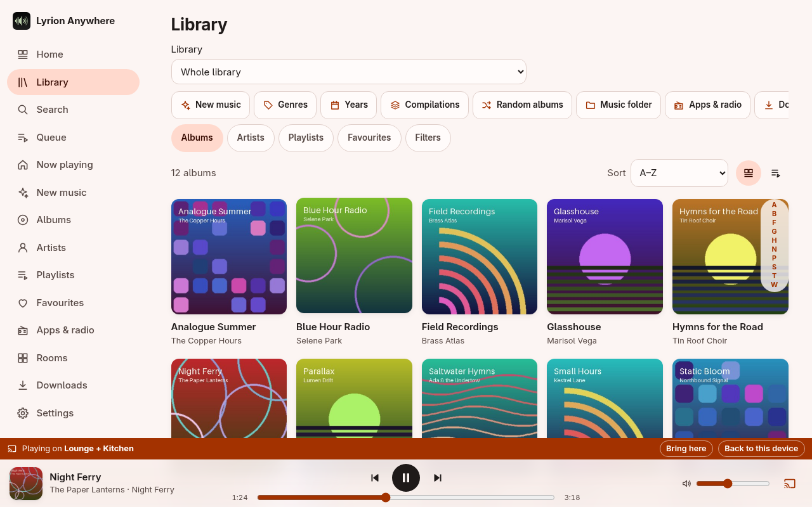

  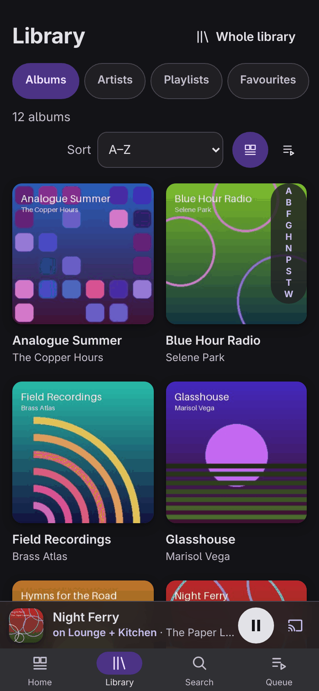
  &nbsp;
  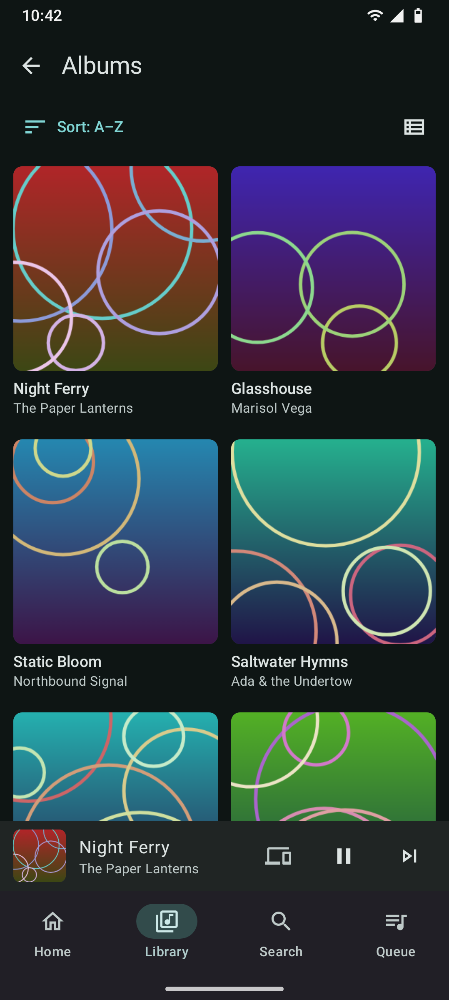
  &nbsp;
  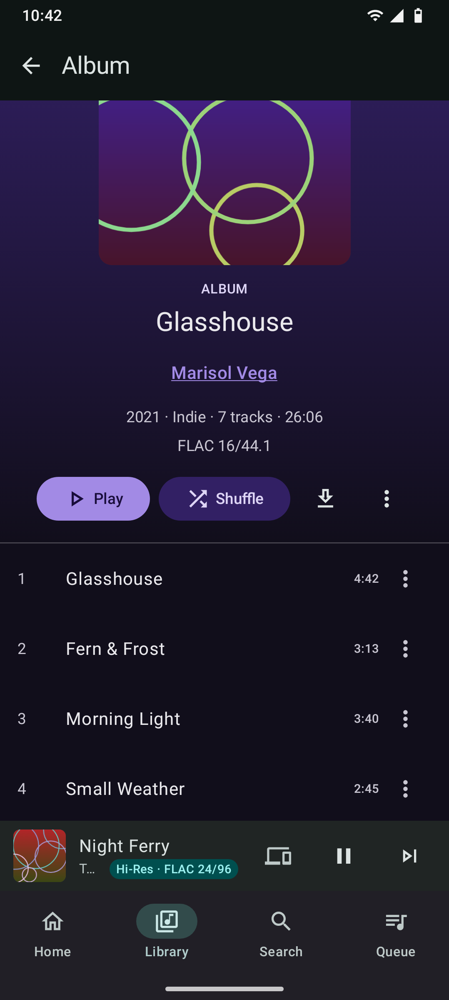

  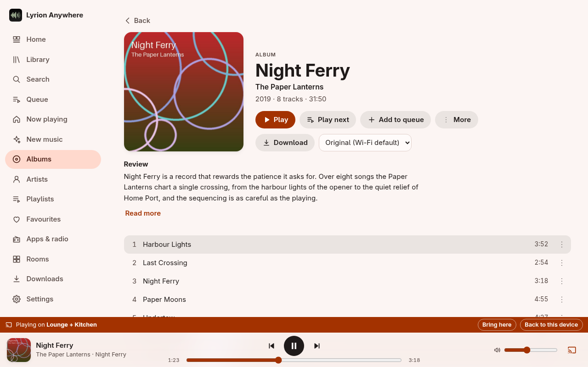

  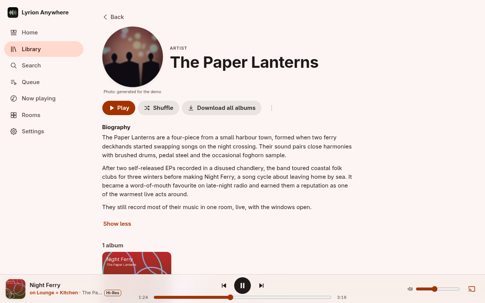

| Feature | Where | Details |
|---|---|---|
| **All of LMS's "My Music"** | Both | New Music, albums, artists by role (album artists by default, all artists, composers, conductors and bands where the library has them), genres (albums or artists), years, compilations, random albums ("Shuffle again"), the music folder (browsed by id; paths never reach the app), playlists and favourites |
| **Library sections, sort and view** | Both | One list of sections. Web: Albums, Artists, Playlists, Favourites, Smart playlists, Genres, Years, Compilations, Folders, Apps & radio and Downloads, as one row shown in place; `/albums`, `/artists`, `/new` and `/random` open the section. Android: Albums, Artists, Playlists, Favourites, Downloaded, Smart playlists, then Browse (Genres, Years, Compilations, Folders, Apps & Radio), each a page of its own. Albums by Recently added, A–Z, Artist, Year or Random (one batch with *Shuffle again*; web also Recently played), as a grid or a list; remembered on the device |
| **A–Z fast scroller** | Both | Built from LMS's own index, so a letter loads only its own page; works with the keyboard, screen readers and TalkBack |
| **Virtual libraries** | Both | When LMS has any, a picker (in the Library header's ⋯ on the web) narrows every browse list; remembered per user on the device |
| **Album pages** | Both | Artwork, details (year, genre, format such as "FLAC 24/96"), discs, and one row of actions that never wraps: Play, Shuffle, Download and ⋮/⋯ (Play next, Add to queue; web: Download as…, More…, Remove download; Android: Start radio), plus the album's review where the server has one |
| **Artist pages** | Both | Albums grouped (Albums, Appears on, Compilations), "Appears as" chips by role, Play, Shuffle, Download all albums (web) and ⋮/⋯ (Add to queue, More…), and the artist's biography and photo where the server has them |
| **One way to act on a page or row** | Web | Page headers are Play · Shuffle · Download · ⋯ at most (album, artist, playlist, genre, year, folder, smart playlist); a row has at most one trailing control, its ⋯; destructive actions (Delete, Remove download, Clear) only inside a menu, last, and confirmed |
| **Tappable credits** | Both | Track information lists everyone LMS credits by role; each name opens that person's albums in that role ("Name · Composer") |
| **Smart playlists** | Both | A rule builder (1–20 genres, a decade, an artist in an optional role, compilations or not; an order and up to 500 albums), saved per user on the server; each has its own page, and Play and Shuffle load its first 50 albums. One can be a Home shelf |
| **"More…" menus** | Both | Play now, Play next and Add to queue, then LMS's own context menu for the track, album, artist, genre, year, folder or playlist, including every plugin action |
| **Apps, radio and plugins, found automatically** | Both | Whatever LMS offers (podcasts, radio directories, streaming services, AudioMuse-AI, Custom Browse, Random Mix and more) appears with nothing hard-coded, including plugins that add themselves to My Music. Each is judged from its own top menu: ones that need setting up in LMS say so; empty or broken ones are tucked behind "Show all" |
| **Favourites and saved playlists** | Both | Browse and play; admins can also create, rename, delete, reorder and remove tracks from playlists (shared household data, so listeners can't change them) |
| **Swipe on browse rows** | Both | Swipe right to play next, left to add to the queue; each also a menu item and a screen-reader action |
| **Tablet and wide layouts** | Both | Wide windows show the chosen album, artist or playlist beside its list (Android) and pin the queue beside Now playing |

## Search

  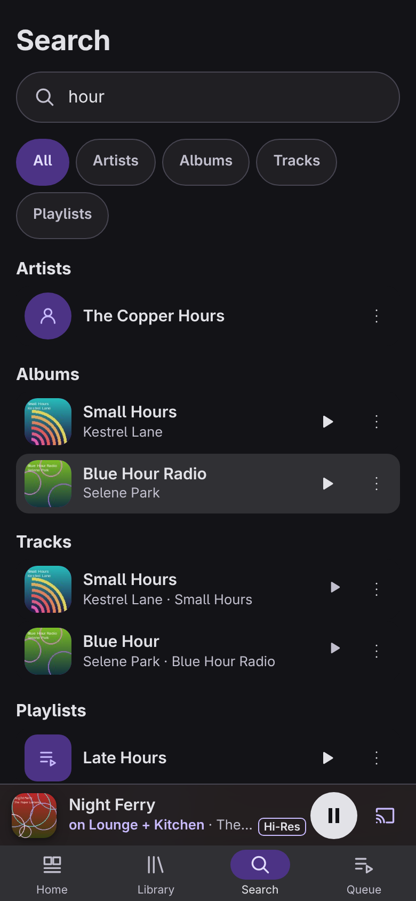

| Feature | Where | Details |
|---|---|---|
| **Library search** | Both | Instant results grouped under a *Top result*, with type chips that page through one type; play, play next or add from any result |
| **Recent searches** | Both | Kept on the device only; each removable, with *Clear all* (Android keeps up to 20) |
| **Search on apps** | Both | Below the library results, one row per app or radio service that offers a search ("Search <app> for …"), found from each app's own menu; opens that app's results |
| **Safe by construction** | Server | Search text that holds a path, a `file:` URL or a home-network address is refused before it reaches LMS |

## Queue

  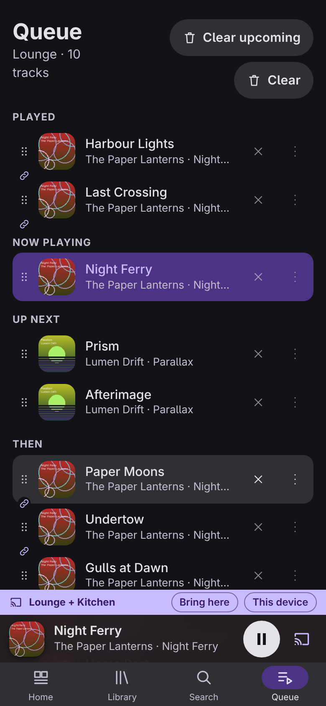
  &nbsp;
  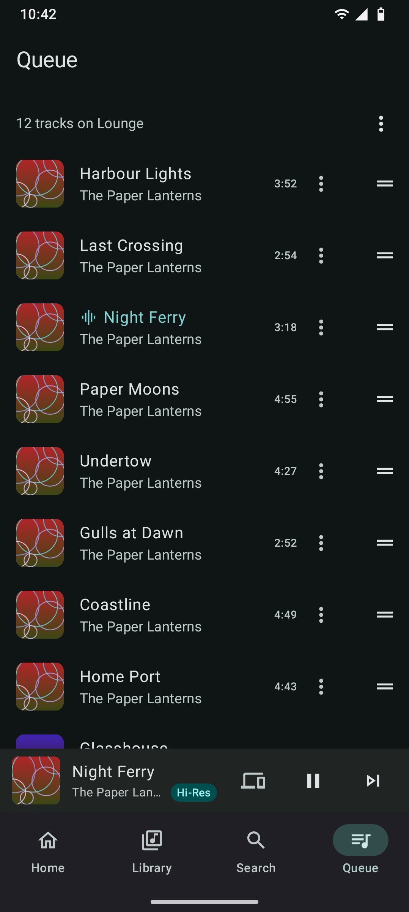

| Feature | Where | Details |
|---|---|---|
| **Sections** | Both | *Now playing*, *Up next* (what this device added with Play next) and *Then*; shown flat when the queue changes elsewhere |
| **Reorder and remove** | Both | Drag by the handle (or Alt+Up/Down, or *Move up* / *Move down* in a row's ⋯); swipe left to remove and right to play next, with Undo; tap to play. On the web a row is the handle, the track and its ⋯ (Play next, Move up, Move down, Remove from queue) |
| **Checked edits** | Both, Server | Removes and moves are checked against the entry on the server first, so an edit made after someone else changed the queue can't hit the wrong track |
| **Clear** | Both | *Clear upcoming* (asks first, removes from the end checking each entry), or *Clear all* for a long queue; both are in the queue's ⋮/⋯, with *Save as playlist*, and clearing asks first |
| **Save as playlist** | Both, Server | Admins save the queue as a saved playlist from the Queue page's ⋮/⋯. The name starts as the album (for a one-album queue) or the date, and is checked as it's typed; a playlist of that name is replaced only if you say so. Then a message with a link to the new playlist. Radio and streaming entries are saved as LMS saves them, by their URL |
| **Shuffle and repeat** | Both | Shuffle cycles Off, Tracks and Albums (a long press offers all three). Whether a track plays straight on (gapless) is in its Track info |
| **Queue peek** | Both | Swipe up on the cover (or the Queue button) for the queue in a sheet; a Queue tab on phones |
| **Offline marks** | Both | One *Downloaded* mark (an arrow in a circle) on every track row whose track is downloaded, on any player: the queue, album and playlist pages. The *On this device* mark (the stream this device holds in full, while it is the player) shows only while your music server is out of reach. Both are in the row's accessible name. Web: out of reach, rows that can't be played here are dimmed and can't be tapped, and a queue that couldn't be read says so rather than "empty" |
| **Queue actions** | Both | The header is the title and ⋮/⋯ (*Save as playlist*, *Clear upcoming*, *Clear queue*). A row has its drag handle and ⋮/⋯ (Play next, Move up, Move down, Remove) |

## Now playing, lyrics, visualiser and signal path

  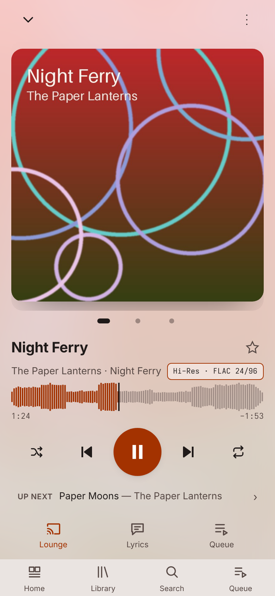
  &nbsp;
  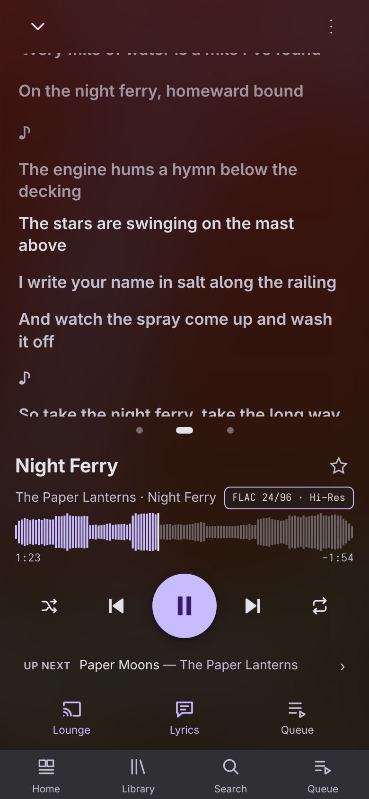
  &nbsp;
  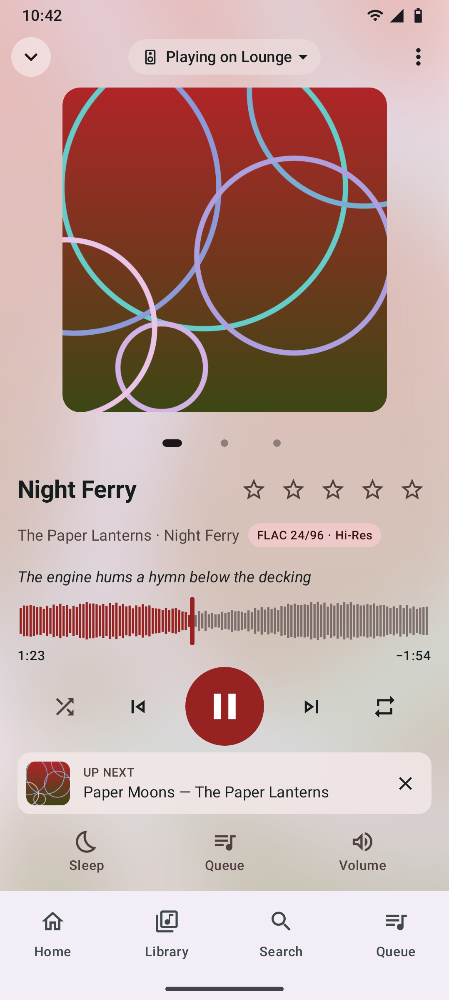

  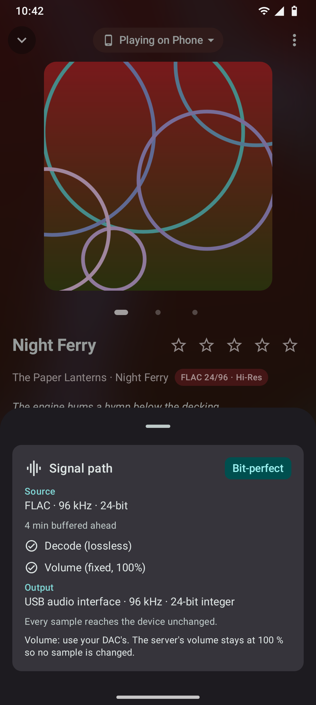
  &nbsp;
  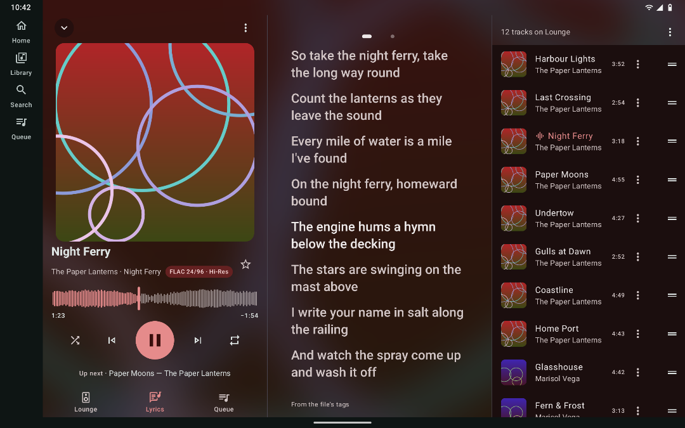

| Feature | Where | Details |
|---|---|---|
| **One screen that never scrolls** | Both | On phones the transport is always fully on screen (checked at 360 × 640). Wave 3.5, both: a top row (close and ⋮; Android also the sleep timer's time left), the hero, the title with one rating control, artist and album with the quality badge, the waveform seek bar, the transport, a one-line Up next, and three actions: Play on (named after the player), Lyrics and Queue. ⋮ holds This track (with the full rating), Sleep timer, the visualiser and Car mode (Android also Volume, alarms and power; on the web the volume is in Play on… and a player's alarms are its row there). Android hides the tab bar. Web wide windows: Queue and ⋯ (Sleep timer, This track, Signal path, Car mode), and no player bar underneath |
| **Hero pager: Cover, Lyrics, Track info** | Both | Swipe between them, use the dots (tabs for screen readers) or the keys 1–3; remembered per device. Wide windows keep the art on the left with lyrics or info beside it, and can pin the queue |
| **Waveform seek bar** | Both | Each track's waveform, analysed on your server, as the seek bar, with elapsed and remaining time; a plain bar where analysis is off |
| **Lyrics** | Both | From the file's tags (plain or synced LRC), or from the *Music & Artist Information* plugin if installed. Synced lyrics highlight the line and follow it; tap a line to seek there. An optional one-line peek on Android |
| **Track info and credits** | Both | Album and year, artist, genre, format, length and credits as links |
| **Artist biographies, photos and album reviews** | Both | From the *Music & Artist Information* plugin, cleaned to plain text on the server; photos only through the gateway's image proxy |
| **Quality badge and signal path** | Both | e.g. **FLAC 24/96 · Hi-Res** or **MP3 320**; tapping it opens the signal path: the source, decoding, re-encoding, volume and processing, the output and its rate, and (Android) the route, buffered cushion and a bit-perfect verdict with every reason it falls short |
| **Ratings** | Both | Stars (half steps by keyboard or TalkBack) or a heart, as each user chooses; kept per user on the server by stable key, blended with LMS's shared rating, and passed to Ratings Light where installed. Rated offline on Android, sent later. Now playing has one control by the title (web: a toggle that loves the track or clears it; Android: the heart toggles, the star opens the full rating); the full 1–5 rating is in ⋮ (web: ⋮ › This track) |
| **Up next** | Both | The next track under the transport, one line of text; a tap opens the queue; swipe it away (or Delete, or TalkBack's action) to remove it, with Undo |
| **Ambient background** | Both | The cover blurred and drifting behind Now playing, with a scrim that keeps text at WCAG AA over any cover; still under reduced motion, battery saver and on low-power devices; off in high contrast |
| **Art-driven colour** | Android | Album, artist and Now playing pages take their colour from the cover, with every text colour adjusted to meet contrast |
| **Visualiser** | Both | Bars, Scope, VU meters (with needle ballistics and peak hold) and Glow (a halo in the cover's own colours that pulses on the beat). Only while this device is the player; off by default, off under reduced motion (and battery saver on Android), and decorative for screen readers. In ⋮: switch it on or off and choose the style; a swipe across it changes the style. Web wide windows keep their toggle and style button. Also for downloads on Android |
| **Mini player gestures** | Both | Swipe left or right for next or previous, up or tap to open Now playing, long-press for *Play on…*; each also a button, key and screen-reader action |

## Sound and DSP

  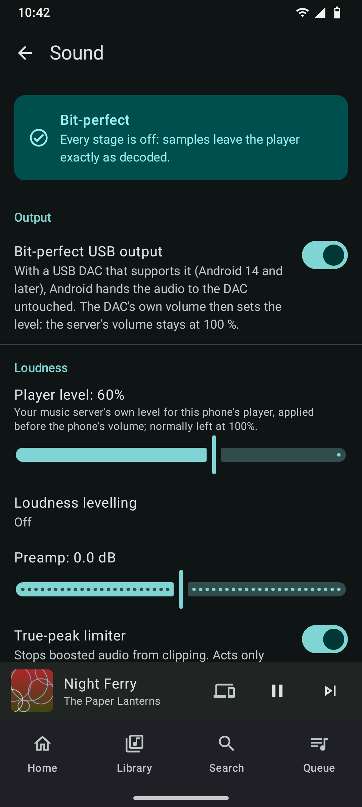
  &nbsp;
  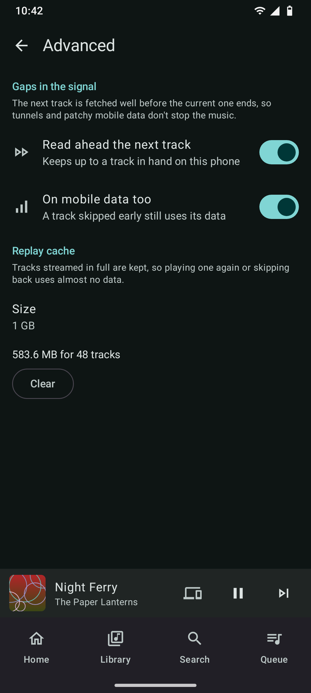

All of these are on Android, for this phone's player, and are **off by default**, so playback stays bit-perfect. A *Bit-perfect* indicator changes as soon as any stage is on, and the signal path shows each stage. They apply to streaming and downloads alike.

| Feature | Where | Details |
|---|---|---|
| **Bit-perfect output** | Android | DSP off and LMS's volume at 100 % leave samples untouched; the output opens at the source's rate |
| **Bit-perfect USB DAC** | Android | On Android 14 or later, with a DAC that offers it, Android's bit-perfect mixer mode at the track's rate and depth (16, 24 or 32-bit integer). Volume is then the DAC's own. Falls back to Android's mixer whenever the phone, DAC or format refuses |
| **Preamp and true-peak limiter** | Android | A preamp, and a 4× oversampled true-peak limiter with an adjustable ceiling that catches every boost |
| **Loudness levelling** | Android | ReplayGain (track or album) from the file's tags, or the server's EBU R128 analysis (to −18 LUFS), falling back to tags |
| **Parametric EQ** | Android | From an AutoEq profile (pasted or picked as a file), with a frequency-response curve and an A/B bypass |
| **Per-output EQ** | Android | Bind a profile (or "no EQ") to the speaker, wired headphones, a USB DAC or a Bluetooth device by name; it switches by itself as the output changes |
| **Loudness-compensated volume** | Android | At low volume, low and high shelves restore the bass and treble the ear loses (ISO 226), following both the player level and Android's media volume; bypassed on a bit-perfect route |
| **Crossfeed** | Android | Light, Moderate or Natural, for headphones |
| **Dither** | Android | TPDF or shaped TPDF, only where bit depth is reduced |
| **Crossfades and smart transitions** | Android | 1–10 s, never between tracks of the same album; smart transitions trim silence and follow each track's own fade from the server's analysis |
| **Player level** | Android | LMS's own volume for this phone, normally left at 100 % |

## Discovery and radio

  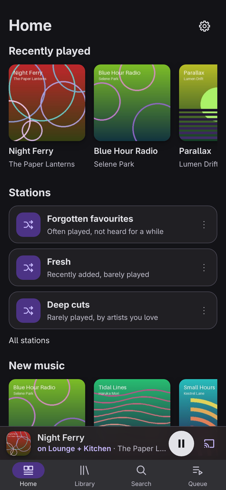
  &nbsp;
  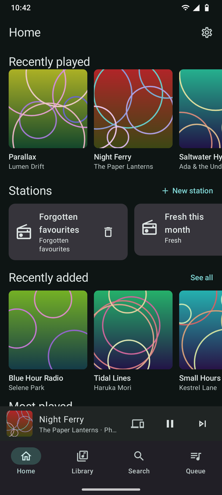

| Feature | Where | Details |
|---|---|---|
| **Customisable Home** | Both | Your own shelves (recently played, stations, new music, most played, on this day, random albums, favourites, playlists, a genre, a station, a smart filter or a pinned menu), saved per user on the server so every device shows the same. Edit in place: reorder by dragging or Move up/down, hide, add, remove, reset |
| **Stations** | Both | Endless stations computed on the server from your library and history: forgotten favourites, fresh, deep cuts, several genres, a decade (optionally favouring what you've played). A single genre plays as LMS's Random Mix. Stations avoid your last 200 plays. Android: a tap plays a station; deleting one is in its ⋮ (or a long press), never on the card |
| **Save as station, Pin to Home** | Both | Save any plugin menu item (a mix, say) as a station or pin it to Home. What is stored is a reference to the action LMS offered, replayed under your own permissions each time; if LMS stops offering it, the station says so and nothing runs |
| **Start radio and More like this** | Android (Web: Start radio in car mode) | From a track, album or artist: AudioMuse-AI's mixes where the server has them, or LMS's Don't Stop The Music. Hidden when the server offers neither |
| **Voice search** | Android | "Play … on Lyrion Anywhere" from the phone's assistant, and voice search in car mode and Android Auto |

## Offline and downloads

  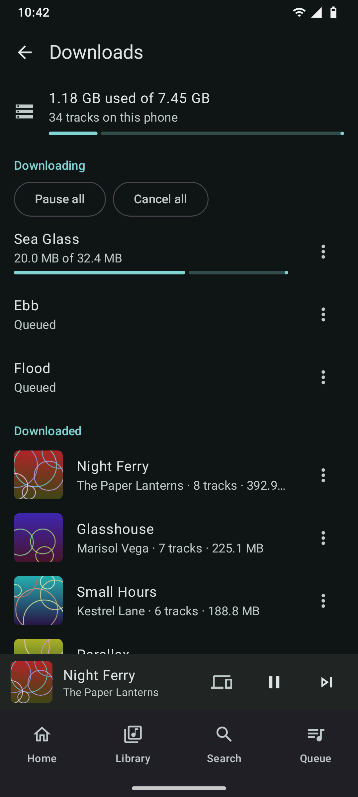

| Feature | Where | Details |
|---|---|---|
| **Download for offline listening** | Both | Albums (or the rest of one), playlists and single tracks; on the web also all of an artist's albums. Local library files only, never streaming services or radio |
| **Three formats** | Both | Original (bit-perfect), Opus 160 kb/s or MP3 320 kb/s, with separate defaults for Wi-Fi and mobile data. Transcoded formats need `ffmpeg` on the server; an admin can limit the formats per user or turn downloads off |
| **Resumable downloads** | Both | Two at a time, resumed with HTTP ranges after a break (even after a reload or restart), checked against the server's size and stable key; pause, resume and cancel |
| **Wi-Fi only and a storage cap** | Both | Android: *Download on Wi-Fi only* is on by default and can be turned off in *Settings › Downloads › Download options*; on mobile data downloads wait. Web: *Download on Wi-Fi only* is on by default and works where the browser reports mobile data (Chrome on Android), with *Waiting for Wi-Fi* and a *Download now* override; elsewhere downloads always start. A storage limit (none by default) refuses a download that won't fit, saying how much it needs and how much is free |
| **Smart downloads** | Android | *Keep recently added albums offline (N)* and *Keep favourites offline*, refreshed on Wi-Fi within the storage cap; they never remove your own downloads |
| **Downloads page** | Both | What is downloading, what is on the device (by album; on the web also playlists as their own groups), storage used, remove and remove all; the web page also shows the storage limit, the browser's quota and whether it keeps storage persistent. Removing a playlist or album keeps tracks another download still needs |
| **Offline mode** | Both | When the server can't be reached, the downloaded library is shown and plays on the device; Android switches back by itself when the server returns |
| **Busy music server** | Android | When LMS stops answering for a while (its music share waking up, say) and the gateway says so, a calm *Your music server is busy. Waiting for it…* note shows instead of an error or offline mode; buffered audio keeps playing, polling backs off, and the app catches up as soon as LMS answers. A command refused meanwhile says so briefly and isn't replayed |
| **Quiet reconnects** | Android | Losing the connection in the background doesn't count as being offline. Back in the app, it reconnects at once on the screen you were on, with a one-line *Reconnecting…* note at the top; if the server stays out of reach, *Can't reach your server.* (a tap opens the downloads) instead of a takeover. The line takes its own space, never covering the controls. Offline mode takes over only with no network at start, or after 15 s unreachable while in use, and hands back to the same screen, back history and scroll position |
| **Controls with the server away** | Android | While the server can't be reached, controls that can't work are greyed out (everywhere: Now playing, the mini player, the queue, the notification, the lock screen and Android Auto). On this phone's player, play and pause still work at once, and next, previous, a queue row and seeking work for tracks the phone has whole (downloaded, or kept from streaming), playing on from its own copies until the next track needs the server. Queue rows are marked *Downloaded* or *On this device*. Back online, LMS picks up where the phone is, if its queue hasn't changed |
| **A busy music server** | Web | When LMS stops answering for a while (its music share spinning up, say), the gateway says so at once instead of letting requests pile up. The web app shows a calm *Your music server is busy. Waiting for it…* status rather than an error or offline mode, keeps playing what it has buffered and stays connected, polls less often until LMS answers, then catches up by itself. Controls that need LMS are disabled meanwhile, as when the server is out of reach; nothing is queued to run later |
| **Controls that work without the server** | Web | When the server can't be reached for more than 3 s (or the browser is offline), controls that can't work are greyed out rather than failing. With this browser as the player, Play/Pause still works (the position is kept), Next, Previous and the queue jump to tracks on this device (downloads, or the stream it holds) and back, a download can be sought, and playback goes on to the next track here at the end of one (or stops, saying the next one needs the server). The lock screen offers only what works; library play actions and the Rooms page's controls are disabled too. When the server is back, LMS is told where this device got to, unless someone changed the queue meanwhile; nothing done here, nothing told. One compact *Can't reach your server* chip at the top of the page, on phones too, never over the controls, and no error per command. Every control that needs the server (Download, LMS's More menus, *Move playback to …* and grouping in Play on… too) is greyed out the same way, and says why: its tooltip and description point at the chip |
| **Reloads with the server away** | Web | A route typed into the address bar opens in the app instead of reloading it. A page that does load while the server is out of reach comes back signed in (provisionally, until the server confirms it) and shows what was last playing, rather than a bare *Can't reach* page; the same while the music server is busy. Offline mode's splash is only for a device with nobody signed in |
| **Offline playback** | Both | Android: the app's own queue through the same engine as streaming (DSP, levelling, bit-perfect USB, gapless, signal path), with the notification and Bluetooth buttons. Web: the browser's audio element with lock-screen controls. Wave 3.5, both: downloads use the main mini player, Now playing (*Stop* in ⋮) and Queue (Android: as a player called *Downloads*); the downloads queue can't be edited there |
| **Continue on a player** | Both | Back online with downloads queued (playing or paused), an offer to *Continue on* a player you may control (this device's own player when it was the one in use, else the last one used), or *Not now*: on the web a snackbar with *Continue* and *Other player…*; on Android a one-line banner with ▾ to choose the player and ✕ for Not now. It never happens by itself. The queue goes in order, at the current track and position, playing or paused as it was; then the downloads stop. Tracks no longer in the library are skipped and counted; if anything fails, the downloads carry on |
| **Plays counted in LMS** | Both, Server | Each play heard offline (half the track or 240 s) is queued on the device and sent when back online; LMS's play count and last played are updated. Retries never count twice; the web Downloads page shows "N plays waiting to sync" |
| **Downloads kept per user** | Both | Another account signing in on the same device doesn't see them. Signing out asks whether to remove them (keeping is the default) |
| **Revocation clears downloads** | Android | A device revoked by the server deletes its downloads at its next connection |

## Listening history, stats and Your year

  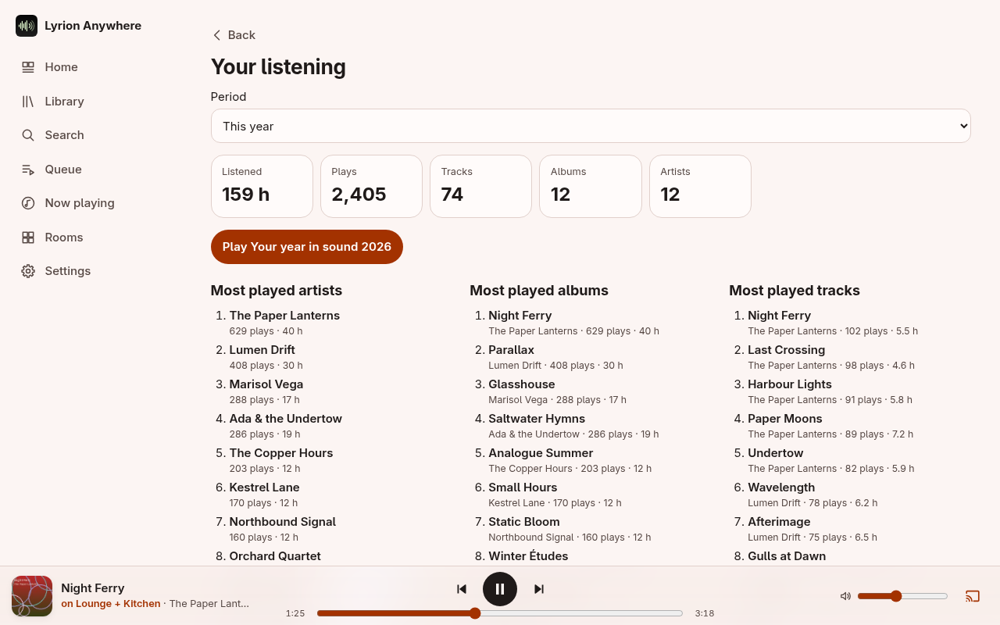

  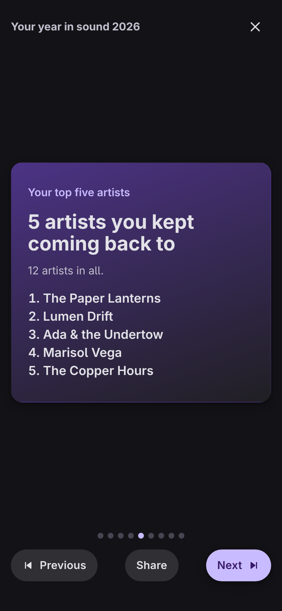
  &nbsp;
  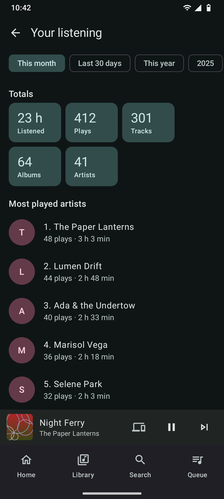
  &nbsp;
  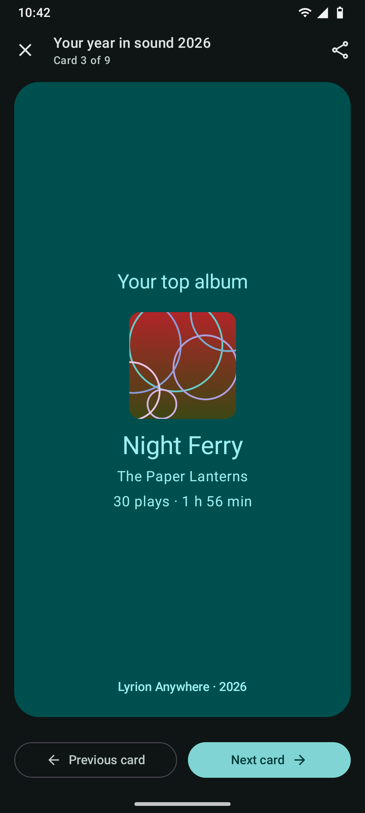

| Feature | Where | Details |
|---|---|---|
| **Listening history** | Server | Your plays through Lyrion Anywhere (on your own devices, or offline), kept per user for 13 months. Hardware players and other people's devices are never attributed to you. View, clear or switch it off in *Settings › Listening history* |
| **Your listening** | Both | Hours, plays and different tracks, albums and artists for this month, the last 30 days, this year, each past year or everything kept; most played artists, albums and tracks; new artists; charts by hour, weekday and month (each with a text alternative); the longest streak and busiest day |
| **Home card** | Both | "This month: 23 h · 412 plays", linking to the page |
| **Your year in sound** | Both | A story of full-screen cards: hours, top artist, album and track, top five, a new discovery, the busiest hour, the longest streak and a summary. Offered from 1 December to 31 January, and on demand for any year. Nothing moves on its own |
| **Share a card** | Both | The card is drawn as an image on the device and handed to the share sheet (or downloaded); nothing is uploaded |

## Car, Android Auto, widgets and system surfaces

  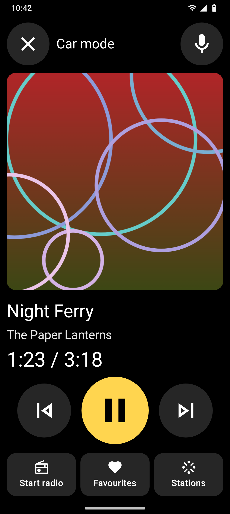

| Feature | Where | Details |
|---|---|---|
| **Car mode** | Both | A driving screen from Now playing: huge art, giant previous, play/pause and next (hold play/pause to stop), *Start radio*, one level of Favourites and Stations, targets of at least 76 px (76 dp on Android), high contrast, and the screen kept on while playing. Android adds voice search |
| **Car mode opens by itself** | Android | *Off*, *Any car audio* or *This device* (a chosen paired Bluetooth device); Bluetooth permission asked only when an automatic option is first chosen |
| **Android Auto** | Android | Browse Home, Library and Downloads with album covers, search, and ask by voice; everything plays on the phone (or from downloads with no server). Every caller is checked: Android Auto and the Google assistants only with their genuine certificates |
| **Home-screen widgets** | Android | A small widget (art, title, artist, play/pause, next) and a larger resizable one with a progress line and previous; drawn only when what they show changes, so they never wake the phone |
| **Quick Settings tile** | Android | Play/pause for this phone's player |
| **App shortcuts** | Both | Android: *Start radio* and *Sleep 30 min*. Web (installed app): *Resume*, *Radio* and *Search* |
| **Haptics** | Both | Light ticks on a skip by swipe, scrub detents, volume steps, drag pick-up and drop, ratings and the sleep timer. Android: on by default, following the system setting. Web: off by default, where the browser supports vibration (Android browsers) |
| **Keyboard shortcuts** | Web | Space, arrows on Now playing and in car mode (seek, Shift for previous/next, volume), `/` for search, `L` for lyrics, `?` for a help sheet |
| **Media Session** | Web | Play, pause, stop, previous, next and seeking from the system, with the position for its progress bar |

## Appearance and accessibility

  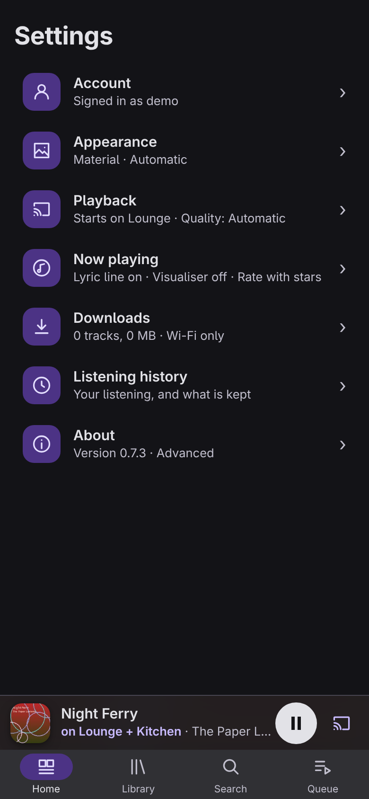

| Feature | Where | Details |
|---|---|---|
| **Themes** | Web | *Material* (Material Design 3, generated from an accent colour: eight presets or any colour), *Classic* and *High contrast*; light, dark or automatic. Palettes are computed in OKLCH and every theme, mode and accent is tested for WCAG AA contrast |
| **Material You** | Android | Material 3, following the system's light or dark setting, with *Wallpaper colours* on Android 12 or later |
| **Layouts** | Both | Phones, tablets, foldables (Android, by Material width classes: navigation rail, two panes) and desktops (a sidebar on the web) |
| **Navigation** | Both | Four tabs on phones: Home, Library, Search, Queue; Settings from a gear on Home. Web sidebar (tablets and desktops): those four, Now playing, Rooms and Settings |
| **Settings is an index** | Web | Seven rows (eight where the browser can install the app), each with a one-line summary of its value and a page of its own: Account, Appearance, Playback, Now playing, Downloads, Listening history, (Install the app,) About (with Advanced: this device's player, playback engine, volume source, diagnostics). Option lists open a picker; every on/off is the same switch, its state in words |
| **One status line** | Web | Moving playback, out of reach, busy and reconnecting share one line at the top of every page (car mode too), the most important first; results and offers are the one snackbar |
| **Screen readers** | Both | Every gesture has a button, key or accessibility action; charts have text alternatives; decorative visuals are hidden; focus is managed in sheets and dialogs. Android screens are covered by automated accessibility audits |
| **Targets and text size** | Both | Touch targets of at least 44 px / 48 dp (76 in car mode); layouts that wrap at 200 % text on Android |
| **Reduced motion** | Both | Ambient drift, visualisers, slides and story animations hold still |

## Accounts, devices, roles and admin

  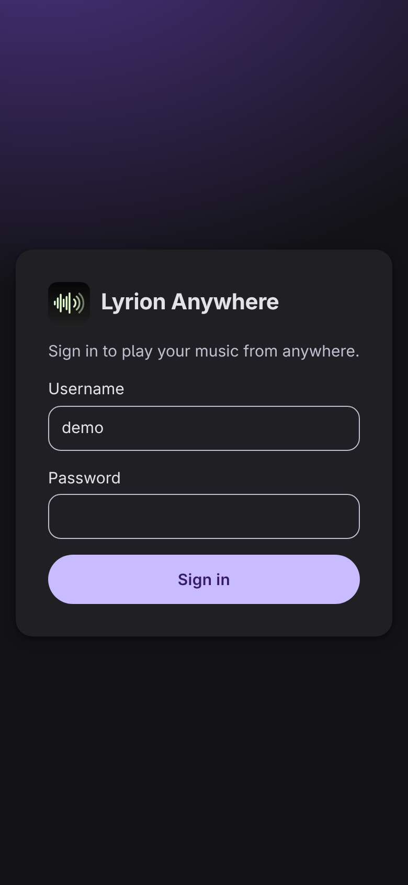

  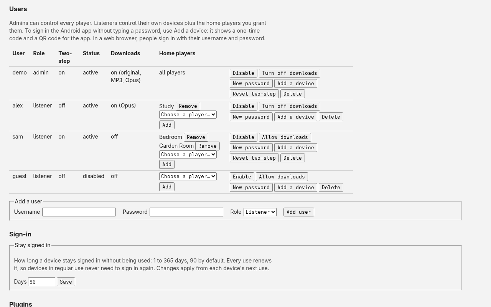

| Feature | Where | Details |
|---|---|---|
| **Accounts of its own** | Server | Created by an admin (no self sign-up), independent of LMS's own password; roles *admin* and *listener* |
| **Two-step verification** | Both, Server | Optional TOTP per user, turned on in the web app (*Settings › Account › Two-step verification*, a dialog that asks for the password once) with an authenticator app; codes asked for at sign-in on both apps. Admins can reset it |
| **Change your password** | Both, Server | *Settings › Account › Change password* on the web and Android: the current password, the new one twice and a two-step code when that is on. Wrong guesses count towards the sign-in lockouts. Your other devices stay signed in and are listed afterwards; tick *Also sign out my other devices* to end them instead. Admins can still set anyone's password (that signs the user out everywhere) |
| **Your devices** | Both, Server | *Settings › Account › Your devices* on the web and Android: every device signed in to your account, with *This device* marked, what each is and when it was last used. Sign out any other one (it has to sign in again at once), or *Sign out all other devices*; each asks first. Only ever your own devices, admins included |
| **Stay signed in** | Server | A device in use stays signed in; one unused for the sign-in lifetime (90 days by default, 1–365) must sign in again |
| **Add a device by QR code** | Both, Server | Admins: *Add a device* on the plugin's settings page. Users: *Settings › Account › Add another device* in the web app (with the password). The Android app scans the QR code or takes a `lyrion-anywhere://pair` link, and always asks before signing in |
| **Name your device** | Both | Rename this device (*Settings › Playback* on the web, *Settings › This phone* on Android); its LMS player is renamed too |
| **Player grants** | Server | Admins grant listeners specific home players |
| **Download permission** | Server | On, with every format, by default; admins turn it off or limit formats per user, effective at once |
| **Admin-only plugins** | Server | Reserve any plugin for admins: listeners never see it and its commands are refused |
| **Device list** | Server | Every signed-in device with its user, client type (installed web app, browser tab or Android app), platform, User-Agent, last address and time; rename or sign out (a lost phone) from there |
| **Diagnostics** | Web, Server | The web app reports its playback mode, capabilities and recent connection log; admins read it per device on the settings page |
| **Recent activity** | Server | An audit log of sign-ins, failures, devices and administrative changes |
| **Docker and command-line admin** | Server | Without the plugin, `anywhere-gateway admin` creates users, sets passwords, lists users and devices, makes pairing codes and resets two-step |

## Security features

Every item here is enforced by the gateway, so it applies to every client.

| Feature | Details |
|---|---|
| **LMS never exposed** | Only the gateway is reachable, behind your TLS proxy; it refuses plain HTTP from remote addresses |
| **Default-deny command policy** | An allow-list of LMS commands with every argument typed and bounded; plugin actions only if LMS offered exactly that action to that device; admin-only commands and plugins |
| **Response scrubbing** | File paths, `file:` URLs, home-network URLs and addresses (in any spelling), server identifiers and other servers' players removed from every answer and event |
| **Player tunnel enforcement** | Only the frames a software player sends; the device's own player address; no redirects to another server |
| **SSRF-safe artwork** | Only fixed paths and image URLs LMS itself handed out; local hosts refused by name and by resolved address |
| **Sign-in protection** | argon2id; per-address and per-user lockouts that strangers can't use to lock you out; a cap on concurrent password checks; generic errors |
| **Tokens** | 15-minute access tokens in memory; rotating refresh tokens with reuse detection (in an HttpOnly, SameSite=Strict cookie in browsers; sealed by the Android Keystore on Android); instant revocation |
| **Resource limits** | Caps on connections, sockets per device and user, body and frame sizes, artwork, downloads, transcodes, analyses and per-user request rates |
| **Hardened web app** | Strict CSP with no inline script, `frame-ancestors 'none'`, a restrictive Permissions-Policy, no third-party code at runtime, metadata always rendered as text, `Clear-Site-Data` on sign-out |
| **Hardened Android app** | No cleartext traffic, system certificates only, backups off, a minimal set of exported components each checked, crash reports redacted and never sent automatically |
| **Hardened ffmpeg** | Fixed arguments, no shell, an empty environment, restricted protocols, size and time caps |
| **LAN-side protection** | The plugin's admin commands need a token only its settings page has; the admin API listens on loopback with a secret |
| **Release integrity** | The plugin runs a bundled gateway only if it matches its checksum list; Android releases are signed, with checksums |

Details: [`ARCHITECTURE.md`](ARCHITECTURE.md#4-trust-boundary-and-threat-model), [`PROTOCOL.md`](PROTOCOL.md), [`security/`](security).

## Privacy controls

| Feature | Where | Details |
|---|---|---|
| **No telemetry** | Both | No analytics, advertising, tracking or third-party SDKs; the apps talk only to your gateway |
| **Private listening history** | Both, Server | Yours only; view, clear or switch it off at any time. Clearing it doesn't change LMS's own play counts |
| **Clear my ratings** | Both | Remove all your ratings from the server |
| **Sign out with or without downloads** | Both | Choose whether downloads stay; Android also deletes its sign-in and stream spool |
| **Device addresses for admins only** | Server | Listeners never see device addresses; a signed-out device's address and User-Agent are erased at once |
| **Third-party lookups stay on the server** | Server | Lyrics, biographies, photos and reviews come from your server's own plugins; artist photos are fetched by your server, so your device never contacts the photo's site |
| **Local-only device data** | Android | Car-mode Bluetooth names and per-output EQ device names never leave the phone |

The full policy is [`PRIVACY.md`](PRIVACY.md).

## Installation and the installable app

| Feature | Where | Details |
|---|---|---|
| **LMS plugin** | Server | Install from a repository URL in *Settings › Plugins*; it bundles the gateway for Linux x86_64, aarch64 and armhf and the web app, starts and supervises the gateway, and offers updates |
| **Docker image** | Server | Static, no shell, non-root, distroless; for hosts where the plugin can't run its binary |
| **Tested proxy configuration** | Server | An nginx example run in CI; Caddy in two lines; notes for Cloudflare and other CDNs |
| **Installable web app** | Web | Install from *Settings › Install the app* (Android and desktop Chromium), or *Share › Add to Home Screen* on iPhone and iPad; full screen, its own icon, and it opens offline |
| **Updates that wait for you** | Web | A new version of the web app downloads in the background and waits. An open page keeps working on the version it loaded (its pages still load after the server has moved on), and the status line at the top says *A new version is ready. Reload when convenient.* with *Reload* and *Later*, because a reload stops this device's playback. Coming back to the app looks for a new version at most once an hour |
| **Android distribution** | Android | Signed APKs (per-ABI and universal, with checksums) on GitHub releases; Google Play and F-Droid (reproducible build recipe) being prepared |
| **Demo** | Both | `tools/demo` runs the real gateway and web app against an invented library, with no LMS needed |

See [`INSTALL.md`](INSTALL.md) for the walkthrough and [`DEPLOY.md`](DEPLOY.md) for the reference.
