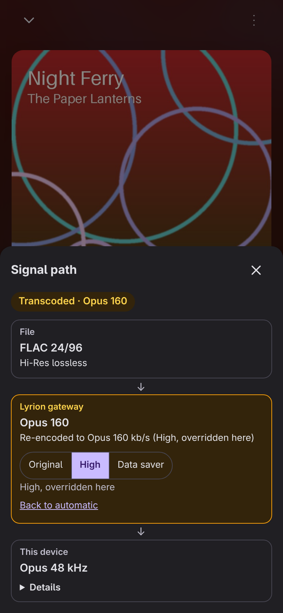
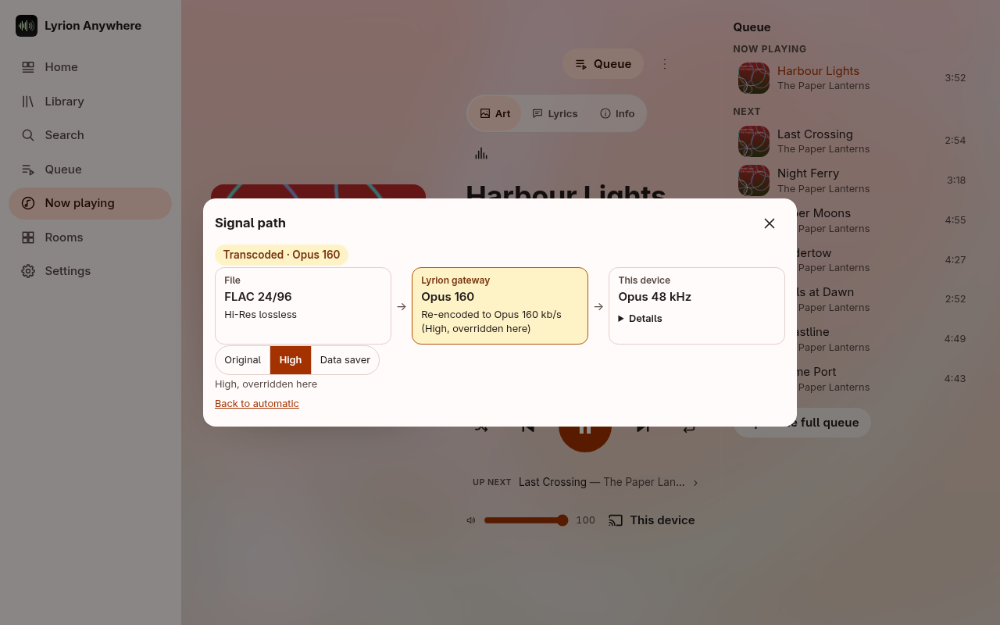
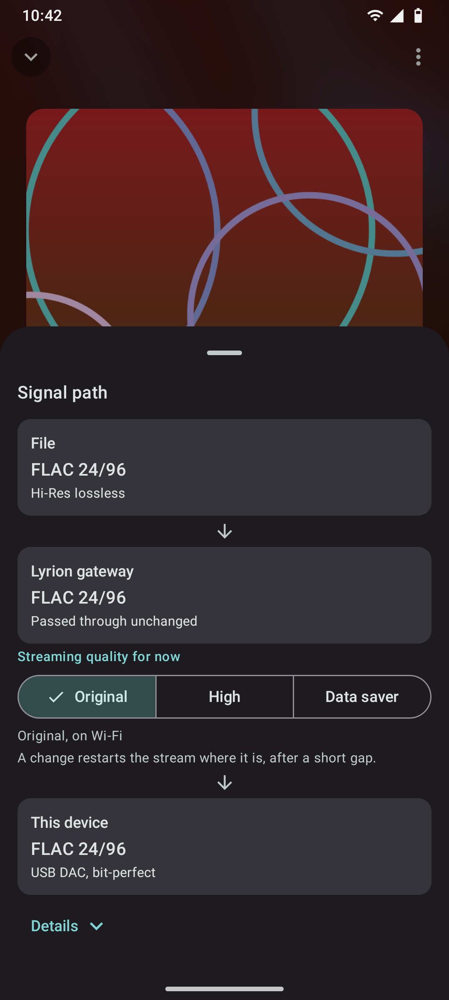
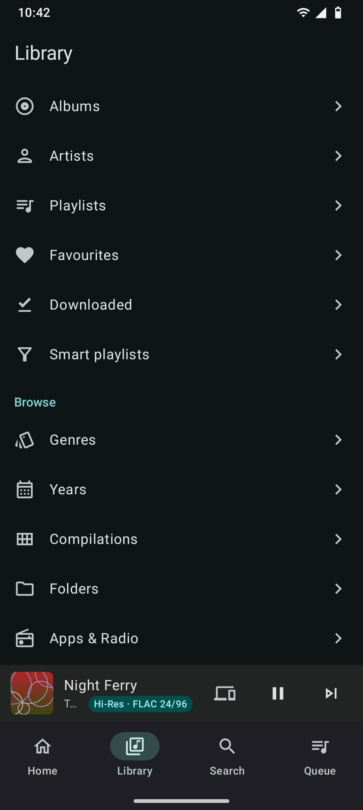
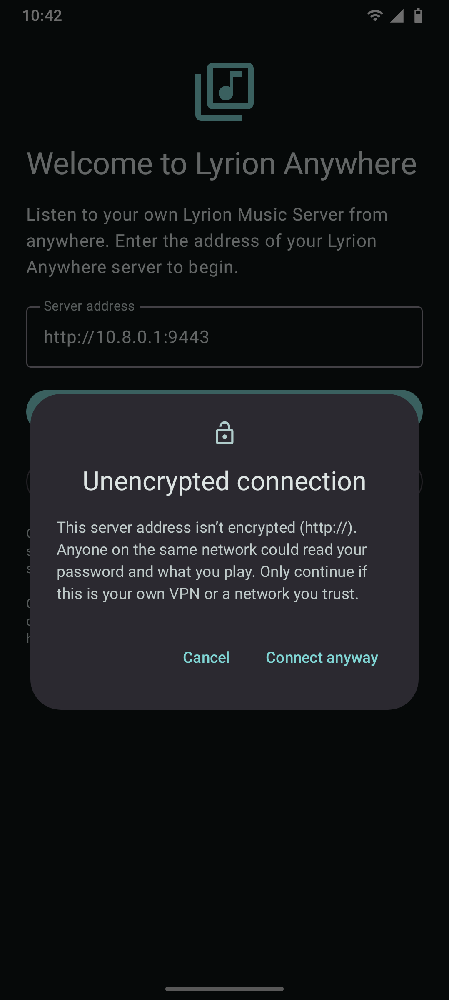
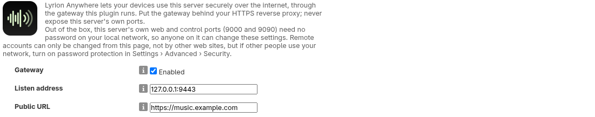
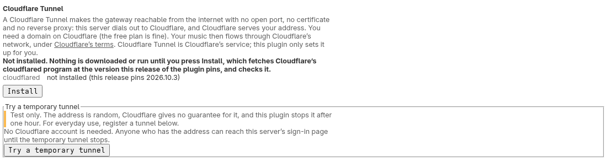
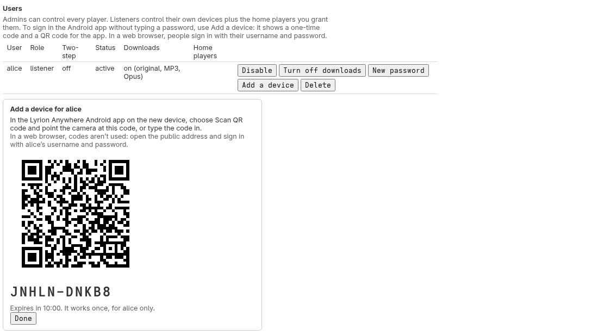
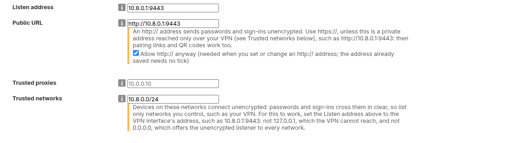
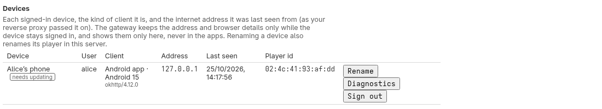

# Screenshots

Every screenshot in the documentation, with what it shows. The library, players, people and artwork are invented: the web shots come from the built-in demo (`tools/demo/shots.sh`), the Android ones from the app's screenshot tests, and the settings-page ones from a throwaway Lyrion Music Server with example values.

## The web app

  
  
  
  

  
  
  
  

  
  

  
  

  
  

  
  
  
  

## The Android app

  
  
  
  

  
  
  
  

  
  
  
  

  
  
  
  

  

## The plugin's settings page

  

  

  

  

  

  

